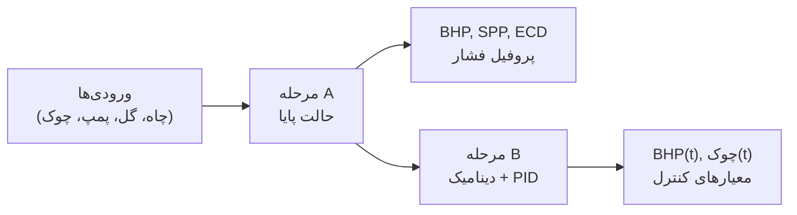
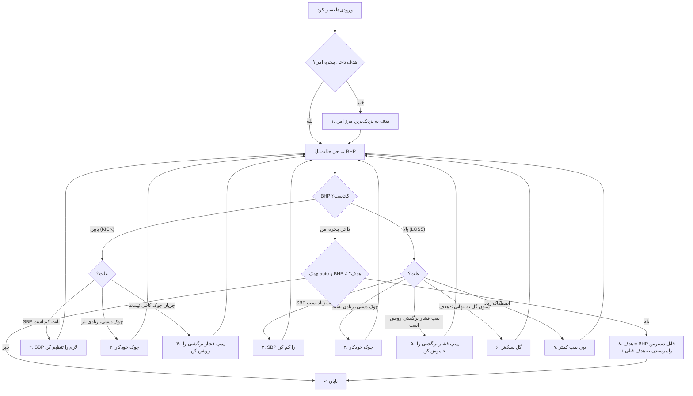
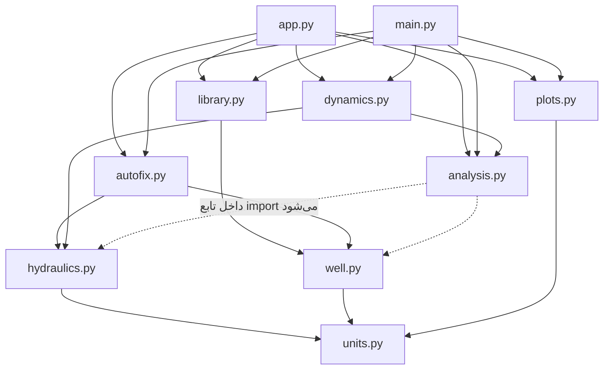
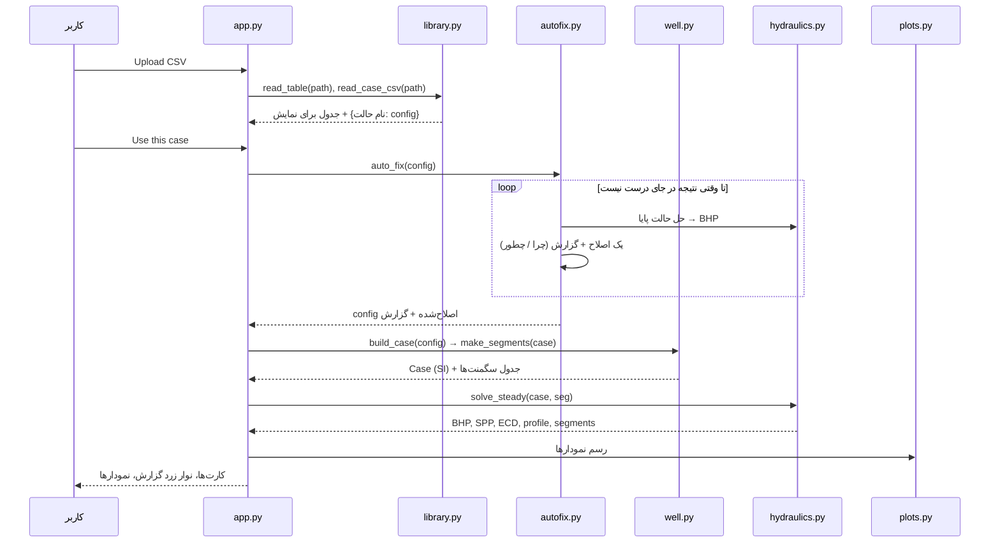

<!-- cSpell:disable -->
# راهنمای لایه‌به‌لایه (پیازی) شبیه‌ساز هیدرولیک چاه MPD

> این راهنما برنامه را **مثل یک پیاز** باز می‌کند: از بیرونی‌ترین لایه (برنامه در یک جمله) شروع می‌کند و لایه‌به‌لایه به درون می‌رود تا به هسته (معادله‌ها و خط‌های کد) برسد.
> هر لایه به تنهایی کامل است؛ برای ارائه می‌توانید در هر لایه‌ای که لازم بود بایستید.
>
> **توجه:** همه داده‌های همراه برنامه **ساختگی (نمایشی)** هستند. این نرم‌افزار برای پژوهش و آموزش است و برای عملیات واقعی حفاری تأیید نشده است.
>
> راهنمای ارائه پایان‌نامه (نظریه، فلوچارت‌ها، سناریوها و منابع) در فایل `README_FA.md` است. این فایل بیشتر روی **کد** تمرکز دارد.

---

## فهرست

- [لایه ۱ – برنامه در یک جمله](#لایه-۱--برنامه-در-یک-جمله)
- [لایه ۲ – کاربر چه می‌بیند (صفحه‌های برنامه)](#لایه-۲--کاربر-چه-میبیند-صفحههای-برنامه)
- [لایه ۳ – معماری: فایل‌ها و جریان داده](#لایه-۳--معماری-فایلها-و-جریان-داده)
- [لایه ۴ – هر فایل چه کاری می‌کند](#لایه-۴--هر-فایل-چه-کاری-میکند)
- [لایه ۵ – درون تابع‌های مهم (خط به خط)](#لایه-۵--درون-تابعهای-مهم-خط-به-خط)
- [لایه ۶ – هسته: فیزیک و ریاضی](#لایه-۶--هسته-فیزیک-و-ریاضی)
- [پیوست الف – فایل‌های داده و تنظیمات، کلید به کلید](#پیوست-الف--فایلهای-داده-و-تنظیمات-کلید-به-کلید)
- [پیوست ب – تست‌ها](#پیوست-ب--تستها)
- [پیوست ج – پرسش‌های احتمالی در جلسه دفاع](#پیوست-ج--پرسشهای-احتمالی-در-جلسه-دفاع)

---

## لایه ۱ – برنامه در یک جمله

**برنامه فشار گل حفاری را در تمام طول چاه حساب می‌کند (مرحله A) و سپس نشان می‌دهد که وقتی پمپ، چوک یا لوله تغییر می‌کنند، فشار ته چاه (BHP) در طول زمان چطور تغییر می‌کند و یک کنترل‌کننده PID چطور با باز و بسته کردن چوک آن را ثابت نگه می‌دارد (مرحله B).**



سه کلمه کلیدی:

| کلمه | معنی ساده |
|---|---|
| **BHP** | فشار ته چاه. باید بین فشار منفذی (Pore) و فشار شکست (Fracture) بماند. |
| **چوک (Choke)** | شیر قابل تنظیم در سطح. بستنش فشار برگشتی (SBP) و در نتیجه BHP را بالا می‌برد. |
| **هدف (Target)** | BHP دلخواه. چوک خودکار و PID سعی می‌کنند BHP را روی آن نگه دارند. |

---

## لایه ۲ – کاربر چه می‌بیند (صفحه‌های برنامه)

اجرا: `.venv/bin/python app.py` — یک پنجره با منوی تیره در سمت چپ و **۷ صفحه**:

| # | صفحه | کار | فایل‌هایی که پشت آن کار می‌کنند |
|---|---|---|---|
| 1 | **Steady state** | ورودی نقطه کاری (دبی، وزن گل، PV، YP، فشار برگشتی، چوک، **هدف BHP**، گزینه **Auto-fix**) → کارت‌های BHP/SPP/SBP/ECD، **نوار زرد گزارش اصلاح خودکار**، نوار پنجره فشار، پروفیل فشار، مسیر چاه، جدول سگمنت‌ها | `well.py`، `autofix.py`، `hydraulics.py`، `plots.py` |
| 2 | **Input file (CSV)** | **بارگذاری یک فایل CSV که همه ورودی‌ها را دارد** (چاه، گل، عملیات، پنجره، چوک، PID، …) و می‌تواند چند گل/حالت را کنار هم داشته باشد؛ خروجی گرفتن از حالت فعلی | `library.py`، `autofix.py` |
| 3 | **Dynamic scenarios** | اجرای یکی از ۱۰ سناریوی زمانی | `dynamics.py`، `analysis.py` |
| 4 | **PID control** | تنظیم Kp، Ki، Kd و مقایسه «با PID» و «بدون PID» | `dynamics.py` (کلاس `PID`) |
| 5 | **Sensitivity** | نمودار تورنادو و جاروب یک پارامتر | `analysis.py` |
| 6 | **Validation** | مقایسه مدل با محاسبه دستی (یا CSV مرجع خودتان) | `analysis.py`، `data/` |
| 7 | **Case file** | دیدن و ویرایش همه ورودی‌ها به صورت متن YAML؛ باز کردن و ذخیره | `well.py` |

پایین منو: انتخاب واحد فشار (bar یا psi)، نام چاه و نام حالت (گل) فعلی.

### ۲-۱. فایل CSV کامل (صفحه Input file)

**یک فایل = همه چیز.** هر ورودی برنامه یک ردیف از این فایل است؛ فایل دیگری لازم نیست (حتی مسیر چاه هم داخل همین فایل است).

1. دکمه **Upload CSV…** را بزنید (یا **Load example** برای `data/case_library.csv`).
2. جدول همه ورودی‌ها را نشان می‌دهد (۱۰۲ ردیف در فایل نمونه).
3. از فهرست بالا یک **حالت** (مثلاً یک گل) انتخاب کنید و **Use this case** را بزنید.
4. برنامه به صفحه Steady state می‌رود، نتیجه را بررسی می‌کند و اگر لازم باشد **خودکار اصلاح می‌کند** (بخش ۲-۲).
5. **Export current case…** حالت فعلی را به صورت یک CSV کامل ذخیره می‌کند؛ بهترین نقطه شروع برای ساختن فایل خودتان.

**قالب فایل:**

```csv
parameter,unit,description,Base WBM 10.0 ppg,OBM 10.5 ppg,Connection - pumps off
name,,Case name,Base case - J-type MPD well (synthetic),,
well.hole_sections.1.name,,Hole section 1: name,Casing 9-5/8 in,,
well.hole_sections.1.diameter_in,in,Hole section 1: diameter_in,8.681,,
well.drill_string.1.length_m,m,Drill string part 1: length_m,3300,,
well.bit.nozzles_32nd,1/32 in,Bit nozzle sizes,13;13;13;13,,
well.survey.1,md_m;tvd_m;inclination_deg;azimuth_deg,Survey station 1,0;0;0;0,,
mud.density_ppg,ppg,Mud density,10.0,10.5,
mud.pv_cp,cP,Plastic viscosity,20.0,24.0,
operation.pump_rate_gpm,gpm,Mud pump rate,500,,0
pressure_window.target_ppg,ppg,Target BHP (EMW),11.0,,
...
```

| قانون | توضیح |
|---|---|
| هر ردیف = یک ورودی | ستون `parameter` جای آن ورودی در فایل ورودی است: `بخش.کلید` (مثل `mud.density_ppg`). اعضای فهرست‌ها از ۱ شماره می‌خورند: `well.hole_sections.2.diameter_in`. |
| `unit` و `description` | فقط برای خواندن انسان هستند؛ برنامه از آن‌ها استفاده نمی‌کند (واحد همیشه در نام کلید است). |
| ستون‌های بعدی = حالت‌ها | هر ستون یک حالت کامل است (مثلاً یک گل). عنوان ستون نام حالت است. |
| حالت اول باید کامل باشد | اگر ورودی‌ای جا افتاده باشد، پیغام خطا **نام همه ورودی‌های جاافتاده** را می‌گوید. |
| خانه خالی در حالت‌های بعدی | یعنی «مثل حالت اول». پس برای یک گل جدید فقط خواص گل را می‌نویسید. |
| فهرست در یک خانه | با `;` جدا می‌شود: نازل‌ها `13;13;13;13`، هر ایستگاه مسیر `md;tvd;inc;azi`. |
| توضیح | خط‌هایی که با `#` **شروع** شوند نادیده گرفته می‌شوند. |
| نام اشتباه | ورودی ناشناخته (مثلاً `mud.density_kg`) همان لحظه بارگذاری گزارش می‌شود. |

ورودی‌های اختیاری (اگر نباشند مقدار پیش‌فرض دارند): `name`، `mud.gel_10min_lbf100ft2`، `operation.clinging_constant`، `pressure_window.warning_margin_psi`، `numerics.low_flow_gpm`.

### ۲-۲. اصلاح خودکار نتیجه (Auto-fix) – با توضیح «چرا» و «چطور»

بعد از هر تغییر ورودی (Calculate، انتخاب حالت از CSV، Apply در Case file، باز کردن فایل) برنامه بررسی می‌کند که **نتیجه در جای درست باشد**:

- **BHP داخل پنجره امن:** `فشار منفذی + حاشیه ≤ BHP ≤ فشار شکست − حاشیه` (حاشیه = `warning_margin_psi`، در چاه پایه 100 psi ≈ 0.2 ppg)
- **BHP = هدف** (وقتی چوک روی auto است)

اگر نباشد، برنامه **خودش اصلاح می‌کند** و در **نوار زرد** بالای صفحه Steady state برای هر مشکل چهار چیز می‌نویسد:

| بخش گزارش | معنی |
|---|---|
| **Problem** | چه چیزی اشتباه است (مثلاً KICK RISK – BHP 345.8 bar زیر حد امن 366.5 bar) |
| **Why** | دلیل فیزیکی |
| **Done** | برنامه چه چیزی را عوض کرد |
| **How to fix on the rig** | در عمل روی دکل چه باید کرد |

گزینه **Auto-fix result** در کادر ورودی: اگر خاموش باشد، ورودی‌ها دست نمی‌خورند و همان گزارش با عنوان «Would do» (پیشنهاد) نمایش داده می‌شود؛ مناسب برای نشان دادن حالت ناامن به استاد.

**ترتیب اصلاح‌ها (کوچک‌ترین تغییر اول):**



هر بار **فقط یک چیز** عوض می‌شود، سپس دوباره حل می‌شود (حداکثر ۶ دور)، تا دلیل هر تغییر روشن باشد.

**نمونه‌ها با `data/case_library.csv`:**

| حالت | مشکل | چرا | اصلاح خودکار |
|---|---|---|---|
| Base / Light / Polymer WBM | — | — | لازم نیست (BHP = 380.4 bar = هدف) |
| OBM 10.5 ppg | BHP 11.36 ppg، امن ولی ≠ هدف 11.0 | ستون گل + اصطکاک حتی با چوک کاملاً باز از هدف بیشتر است؛ چوک فقط می‌تواند فشار **اضافه** کند | هدف = 11.36؛ راه رسیدن به 11.0: گل 10.14 ppg یا دبی 63 gpm |
| OBM 11.0 ppg | LOSS: BHP 11.93 > 11.60 | ستون گل به تنهایی 11.00 ppg = هدف؛ گل سنگین است | وزن گل → 10.07 ppg |
| Heavy mud 11.9 ppg | LOSS: BHP 12.91 ppg | ستون گل 11.90 ppg | وزن گل → 9.99 ppg |
| Connection – pumps off | KICK: BHP 10.00 < 10.60 ppg | بدون جریان، چوک نمی‌تواند فشار نگه دارد | پمپ فشار برگشتی 225 gpm (چوک حدود ۱۰٪ باز) |
| Light mud, choke 90 % open | KICK: BHP 10.23 ppg | چوک دستی زیادی باز است | چوک خودکار |
| Fixed SBP 900 psi | LOSS: BHP 12.47 ppg | فشار برگشتی ثابت زیاد است | SBP → 160 psi |

اگر در کادر Target عدد 13 را بنویسید، به 11.60 (= فشار شکست − حاشیه) منتقل می‌شود و دلیلش گفته می‌شود.

---

## لایه ۳ – معماری: فایل‌ها و جریان داده

### ۳-۱. نقشه پوشه‌ها

```text
sepehr-py/
├── app.py                  پنجره برنامه (Tkinter + matplotlib)
├── main.py                 نسخه خط فرمان → پوشه outputs/
├── mpd/                    «موتور» محاسبات (بدون هیچ کد رابط کاربری)
│   ├── units.py            ثابت‌های تبدیل واحد
│   ├── well.py             خواندن ورودی، تبدیل به SI، مسیر چاه، سگمنت‌ها
│   ├── library.py          فایل CSV کامل (خواندن و نوشتن، چند حالت)
│   ├── autofix.py          اصلاح خودکار هدف و نتیجه + گزارش چرا/چطور
│   ├── hydraulics.py       مرحله A: حالت پایا (بینگهام)
│   ├── dynamics.py         مرحله B: شبیه‌سازی زمانی + PID
│   ├── analysis.py         معیارهای کنترل، حساسیت، اعتبارسنجی
│   └── plots.py            همه نمودارها
├── config/                 فایل‌های ورودی YAML (چاه پایه، سناریوها، چاه اعتبارسنجی)
├── data/                   فایل CSV کامل نمونه، مسیر چاه، داده مرجع اعتبارسنجی
├── tests/                  تست‌های خودکار (pytest)
└── outputs/                خروجی‌های main.py (CSV و PNG)
```

**اصل طراحی:** پوشه `mpd/` هیچ چیزی درباره پنجره نمی‌داند. پس همان توابع هم در `app.py` (پنجره)، هم در `main.py` (خط فرمان) و هم در `tests/` استفاده می‌شوند.

### ۳-۲. چه فایلی از چه فایلی استفاده می‌کند



`analysis.py` توابع `well` و `hydraulics` را **داخل تابع** `run_case` وارد می‌کند تا حلقه import پیش نیاید (چون `dynamics` از `analysis` استفاده می‌کند).

### ۳-۳. مسیر داده از یک کلیک تا نمودار



### ۳-۴. سه شکل داده که در کل برنامه می‌چرخد

| شکل داده | کجا ساخته می‌شود | محتوا | واحد |
|---|---|---|---|
| **config** (دیکشنری) | `load_config` از YAML، یا `read_case_csv` از CSV | دقیقاً همان فایل ورودی | میدانی (ppg، psi، gpm، in) |
| **Case** (dataclass) | `build_case(config)` | همه ورودی‌ها، **یک بار** تبدیل‌شده | SI (kg/m³، Pa، m³/s، m) |
| **seg** (جدول pandas) | `make_segments(case)` | یک ردیف برای هر قطعه ۳۰ متری چاه | SI |

قانون پروژه: **تبدیل واحد فقط دو جا انجام می‌شود** — هنگام ساختن Case (ورود) و هنگام نمایش نتیجه (خروج). همه محاسبات در SI است.

---

## لایه ۴ – هر فایل چه کاری می‌کند

### ۴-۱. `mpd/units.py` – ثابت‌ها

| نام | مقدار | معنی |
|---|---|---|
| `G` | 9.80665 | شتاب گرانش [m/s²] |
| `INCH`، `FT` | 0.0254، 0.3048 | [m] |
| `PSI`، `BAR` | 6894.757، 1e5 | [Pa] |
| `GPM` | 6.309e-5 | [m³/s] |
| `PPG` | 119.8264 | [kg/m³] |
| `CP` | 0.001 | [Pa·s] |
| `LBF_100FT2` | 0.4788 | [Pa] (برای YP و ژل) |

توابع: `psi()`، `bar()`، `ppg()`، `gpm()` برای نمایش؛ `emw_to_pressure(ppg, tvd)` و `pressure_to_emw(p, tvd)` برای تبدیل «وزن گل معادل» به فشار و برعکس: `P = ρ·g·TVD`.

### ۴-۲. `mpd/well.py` – توصیف چاه

| تابع / کلاس | ورودی → خروجی | کار |
|---|---|---|
| `load_config(path)` | مسیر فایل → دیکشنری | خواندن YAML |
| `Case` | — | dataclass با همه ورودی‌ها در SI؛ سه ویژگی محاسبه‌ای: `td` (عمق کل MD)، `td_tvd` (TVD ته چاه)، `bit_depth` (= مجموع طول رشته) |
| `build_case(config)` | دیکشنری → Case | تبدیل واحد، تبدیل پنجره فشار از ppg به Pa در عمق TD، سپس `check_case` |
| `read_survey(well)` | بخش well → جدول md/tvd/inc/azi | از CSV یا فهرست داخل YAML؛ اگر TVD نبود با حداقل انحنا حساب می‌شود |
| `check_case(case)` | Case → (خطا) | بررسی‌های فیزیکی، مثل «لوله بزرگ‌تر از چاه» یا «هدف خارج از پنجره» |
| `minimum_curvature(md, inc, azi)` | آرایه‌ها → TVD، North، East | روش استاندارد حداقل انحنا |
| `make_segments(case)` | Case → جدول سگمنت‌ها | تقسیم چاه به قطعه‌های ≈30 متری؛ مرزها روی تغییر لوله و تغییر قطر حفره هم گذاشته می‌شوند |

### ۴-۳. `mpd/library.py` – فایل CSV کامل

| تابع | کار |
|---|---|
| `complete_config(config)` | کپی فایل ورودی که مسیر چاه را **داخل خودش** دارد (به جای `survey_file`)؛ تا CSV واقعاً همه چیز را داشته باشد |
| `flatten(value)` | فایل ورودی تودرتو → ردیف‌های `(parameter, value)`؛ مثل `well.hole_sections.2.top_m` |
| `unflatten(rows)` | برعکس: ردیف‌ها → فایل ورودی تودرتو (بخش‌های شماره‌دار فهرست می‌شوند) |
| `generic(path)` | `well.hole_sections.2.top_m` → `well.hole_sections.#.top_m` برای مقایسه با الگو |
| `TEMPLATE` | همه ورودی‌های ممکن، ساخته‌شده از `config/base_case.yaml`؛ مرجع «ورودی‌های شناخته‌شده» و «فهرست بودن» |
| `cell_value(text, path)` | خانه CSV → فهرست (با `;`)، عدد (`float` ساده)، یا متن (`auto`) |
| `read_table(path)` | خواندن CSV (حذف خط‌های `#`)، بررسی ستون `parameter` و ورودی‌های ناشناخته |
| `case_names(table)` | نام ستون‌های حالت |
| `read_case_csv(path)` | `{نام حالت: فایل ورودی}`؛ خانه خالی ← حالت اول؛ سپس `check_complete` |
| `check_complete(cfg, name)` | همه ورودی‌های الگو (به جز اختیاری‌ها) باید باشند |
| `write_case_csv(path, cases)` | نوشتن CSV کامل با ستون‌های unit و description (برای Export) |
| `unit_of`، `description_of`، `text_of` | واحد از انتهای نام کلید، توضیح کوتاه، و تبدیل فهرست به `a;b;c` |

### ۴-۴. `mpd/autofix.py` – اصلاح خودکار با توضیح

تابع اصلی: `auto_fix(config)` → `(config اصلاح‌شده، گزارش)`. گزارش فهرستی از دیکشنری‌ها با کلیدهای `problem`، `why`، `done`، `how` است. این تابع **روی کپی** کار می‌کند و ورودی اصلی را تغییر نمی‌دهد.

| تابع | کار |
|---|---|
| `auto_fix` | حلقه: حل → بررسی → یک اصلاح → دوباره (حداکثر ۶ دور) |
| `fix_window` | اصلاح ۱: هدف داخل پنجره امن |
| `fix_too_low` | BHP پایین (Kick): SBP ثابت، چوک دستی، یا پمپ فشار برگشتی |
| `fix_too_high` | BHP بالا (Loss): SBP ثابت، چوک دستی، پمپ فشار برگشتی، وزن گل، یا دبی |
| `on_target` | اصلاح ۸: BHP امن ولی ≠ هدف → هدف = BHP قابل دسترس + راه رسیدن به هدف قبلی |
| `solve`، `safe_limits`، `show` | حل یک فایل ورودی، حدود امن [Pa]، نمایش فشار به bar و ppg |
| `lowest_bhp` | BHP با کمترین فشار سطحی (چوک کاملاً باز یا SBP = 0) |
| `bisect` | روش دوبخشی برای تابع صعودی |
| `needed_sbp` | SBP لازم = هدف − ρgTVD − اصطکاک حلقوی |
| `bp_pump_for` | دبی پمپ فشار برگشتی تا چوک در حدود ۱۰٪ بازشدگی SBP لازم را بسازد |
| `lighter_mud`، `lower_pump_rate` | وزن گل یا دبی پمپ (با دوبخشی) که با کمترین SBP، BHP = هدف بدهد |

### ۴-۵. `mpd/hydraulics.py` – مرحله A

| گروه | توابع | کار |
|---|---|---|
| هندسه | `pipe_area`، `annulus_area`، `hydraulic_diameter`، `hydrostatic` | سطح مقطع‌ها، قطر هیدرولیکی، ρ·g·TVD |
| بینگهام | `reynolds`، `hedstrom`، `critical_reynolds`، `laminar_wall_stress`، `friction` | تعیین رژیم جریان و گرادیان افت فشار برای **همه سگمنت‌ها با هم** (برداری با numpy) |
| مته | `bit_pressure_drop` | افت فشار نازل‌ها |
| چوک | `choke_k`، `choke_pressure_drop`، `choke_flow`، `choke_opening_for` | معادله چوک، وارون آن و پیدا کردن بازشدگی با دوبخشی |
| کل چاه | `annulus_velocity`، `friction_losses` | سرعت حلقوی (با اثر Surge/Swab) و افت اصطکاکی همه سگمنت‌ها |
| حالت پایا | `surface_back_pressure`، `window_status`، `solve_steady` | **تابع اصلی مرحله A** |
| جدول‌ها | `segment_table`، `pressure_profile` | خروجی‌های جدولی برای نمایش و CSV |

### ۴-۶. `mpd/dynamics.py` – مرحله B

| تابع / کلاس | کار |
|---|---|
| `PID` | کنترل‌کننده گسسته با محدودیت خروجی، محدودیت سرعت، ضد اشباع (anti-windup)، فیلتر مشتق و عمل معکوس |
| `schedule_value(points, t, default)` | مقدار یک برنامه زمانی `[[t, value], …]` در لحظه t با درون‌یابی خطی |
| `simulate(case, seg, scenario, progress)` | **تابع اصلی مرحله B**: حلقه زمانی با گام 0.1 ثانیه |
| `update_choke_pressure(...)` | یک گام فشار چوک: مدل lumped، quasi-steady یا محرک فشار برگشتی |

### ۴-۷. `mpd/analysis.py` – تحلیل

| تابع | کار |
|---|---|
| `control_metrics(ts, tolerance, events_s)` | زمان نشست، زمان صعود، فراجهش، خطای ماندگار، IAE، زمان خارج از پنجره؛ کلی و برای هر رویداد |
| `PARAMETERS`، `changed_config`، `run_case` | تغییر یک پارامتر در کپی فایل ورودی و حل دوباره |
| `sensitivity(config, change)` | ±x٪ برای هر پارامتر (تورنادو) |
| `sweep(config, parameter, factors)` | یک پارامتر در یک بازه |
| `percentage_error`، `validate` | مقایسه با جدول مرجع |

### ۴-۸. `mpd/plots.py` – نمودارها

همه توابع روی یک `Figure` داده‌شده رسم می‌کنند، پس یک نمودار هم در پنجره و هم در PNG استفاده می‌شود.

| تابع | نمودار |
|---|---|
| `p_conv(unit)` | تابع تبدیل Pa به bar یا psi |
| `pressure_profile` | فشار بر حسب MD و TVD (داخل لوله و فضای حلقوی) |
| `spp_breakdown` | اجزای SPP (میله‌ای) |
| `window_gauge` | نوار پنجره فشار با محل BHP |
| `trajectory` | مقطع قائم و نمای افقی چاه |
| `dynamic_overview` | چهار نمودار زمانی: BHP، SPP/SBP، دبی‌ها، چوک |
| `ecd_chart`، `pid_chart`، `profiles_over_time` | ECD، اجزای PID، پروفیل در زمان‌های مختلف |
| `tornado`، `sweep_chart`، `validation_chart` | تحلیل‌ها |

توابع با `_` (مثل `_shade_unsafe`) کمکی هستند: سبک محورها، راهنما، خطوط پنجره و سایه قرمز ناحیه ناامن.

### ۴-۹. `app.py` – پنجره

- **توابع ساختمانی** (بیرون از کلاس): `card()` کادر سفید، `kpi()` کارت عدد، `chart()` نمودار + نوار ابزار، `table()` و `fill_table()` جدول، `button()`، `labeled_entry()`، `set_pill()` برچسب وضعیت، `metrics_table()` و `event_table()`.
- **کلاس `App(tk.Tk)`:**
  - `__init__`: ساخت پنجره، خواندن `config/base_case.yaml`، ساخت منو و هر ۷ صفحه، سپس `load_case()`.
  - `sidebar()` و `show(key)`: منو؛ صفحه‌ها روی هم قرار دارند و `tkraise` صفحه انتخاب‌شده را جلو می‌آورد.
  - **`load_case()`**: قلب پنجره. هر تغییری از اینجا می‌گذرد: `auto_fix` (اگر گزینه Auto-fix روشن باشد اعمال می‌شود) → `build_case` → `make_segments` → پر کردن کادرها → `show_report` (نوار زرد) → `calculate_steady`.
  - هر صفحه یک تابع ساخت (`steady_page`، `library_page`، …) و یک یا چند تابع اجرا (`apply_inputs`، `use_case`، `export_case`، `run_dynamic`، `run_pid`، …) دارد.

### ۴-۱۰. `main.py` – خط فرمان

```bash
.venv/bin/python main.py                                   # حالت پایا + ۱۰ سناریو
.venv/bin/python main.py --scenario pid_control            # یک سناریو
.venv/bin/python main.py --sensitivity --validate          # + تحلیل‌ها
.venv/bin/python main.py --case data/case_library.csv --variant "OBM 11.0 ppg"   # فایل CSV کامل
.venv/bin/python main.py --case data/case_library.csv --variant "OBM 11.0 ppg" --no-fix   # فقط گزارش
```

ترتیب: خواندن YAML یا CSV (و انتخاب حالت با `--variant`) → `auto_fix` و چاپ گزارش (Problem / Why / Done / How) → `build_case` → حالت پایا → سناریوها → تحلیل‌ها. نتایج در `outputs/` ذخیره می‌شوند.

---

## لایه ۵ – درون تابع‌های مهم (خط به خط)

### ۵-۱. `build_case` – از واحد میدانی به SI

```python
rho=mud["density_ppg"] * u.PPG,          # 10 ppg → 1198 kg/m3
pv=mud["pv_cp"] * u.CP,                  # 20 cP → 0.02 Pa.s
yp=mud["yp_lbf100ft2"] * u.LBF_100FT2,   # 15 → 7.18 Pa
target=u.emw_to_pressure(win["target_ppg"], tvd_td),   # ppg → Pa در عمق TD
"bulk_modulus": float(cfg["dynamics"]["bulk_modulus_pa"]),
```

- پنجره فشار در فایل به صورت **وزن گل معادل (ppg)** است؛ اینجا با TVD ته چاه به **فشار (Pa)** تبدیل می‌شود.
- `float(...)` لازم است چون PyYAML عدد `1.5e9` را **متن** می‌خواند.
- در پایان `check_case(case)` اجرا می‌شود و اگر خطایی باشد، همه خطاها با هم در یک پیغام برمی‌گردند.

### ۵-۲. `make_segments` – تکه‌تکه کردن چاه

1. **مرزها:** سطح (0)، عمق مته، انتهای هر لوله و انتهای هر بخش حفره.
2. **پر کردن:** هر فاصله بین دو مرز به `n = ceil(طول / 30)` قطعه مساوی تقسیم می‌شود. پس هیچ قطعه‌ای دو لوله یا دو قطر حفره را با هم ندارد.
3. **درون‌یابی:** TVD بالا و پایین، زاویه و آزیموت وسط هر قطعه از جدول survey.
4. **نسبت دادن:** با `np.searchsorted` معلوم می‌شود وسط هر قطعه کدام لوله و کدام حفره است.

نتیجه برای چاه پایه: **117 سگمنت**.

### ۵-۳. `friction` – اصطکاک بینگهام برای همه سگمنت‌ها با هم

```python
re   = reynolds(rho, speed, d, pv)          # Re = ρ v D / PV
he   = hedstrom(rho, yp, d, pv)             # He = ρ YP D² / PV²
re_c = critical_reynolds(he)                # مرز آرام/آشفته (Hanks)
f_lam  = 2 * laminar_wall_stress(...) / (rho * speed**2)   # آرام: حل دقیق
f_turb = 0.0791 * (re * factor) ** -0.25 / factor          # آشفته: Blasius
f = np.where(turbulent, np.fmax(f_lam, f_turb), f_lam)     # بیشینه دو مقدار → بدون پرش
gradient = sign(v) * 2 f ρ v² / D                          # [Pa/m]
```

- همه چیز آرایه numpy است، پس هر ۱۱۷ سگمنت در یک خط حساب می‌شوند (بدون حلقه).
- `sign(v)`: اگر جریان برعکس شود (Swab)، افت فشار هم برعکس می‌شود.
- در رژیم آشفته **بیشینه** دو ضریب گرفته می‌شود تا افت فشار در مرز رژیم ناگهان پایین نپرد.

### ۵-۴. `laminar_wall_stress` – حل نیوتن

معادله دقیق باکینگهام–راینر (لوله) غیرخطی است؛ τw را نمی‌توان مستقیم پیدا کرد:

```python
tau = viscous + k * yp                     # حدس اولیه = فرمول خطی میدانی
for _ in range(50):
    r = yp / tau
    g  = tau * (1 - 4/3 r + r**4 / 3) - viscous     # باید صفر شود
    dg = 1 - r**4                                    # مشتق g نسبت به tau
    tau = max(tau - g / dg, yp)                      # گام نیوتن (τ ≥ YP)
```

حدس اولیه همان فرمول ساده کتاب است، پس روش نیوتن در چند گام همگرا می‌شود.

### ۵-۵. `surface_back_pressure` و چوک خودکار

```python
if case.bp_mode == "fixed":
    return case.back_pressure, None                  # SBP ثابت
q_choke = q + bp_pump + v_pipe * A_pipe              # جریانی که از چوک می‌گذرد
if opening == "auto":
    needed = target − ρ g TVD − annulus_friction     # SBP لازم برای رسیدن به هدف
    opening = choke_opening_for(q_choke, needed, ...)  # دوبخشی روی بازشدگی
return choke_pressure_drop(q_choke, opening, ...), opening
```

`choke_opening_for` بین `min_opening` و `max_opening` جست‌وجو می‌کند. اگر SBP لازم بیرون از توان چوک باشد، بازشدگی روی مرز می‌ماند و BHP به هدف نمی‌رسد — **دقیقاً همین حالت را `auto_fix` تشخیص می‌دهد و اصلاح می‌کند.**

### ۵-۶. `solve_steady` – جمع‌بندی مرحله A

```python
fl = friction_losses(case, seg, q, v_pipe)           # افت هر سگمنت
annulus_dp = fl["dp_annulus"].sum()
sbp, opening = surface_back_pressure(...)
r["spp"] = sbp + dp_drill_pipe + dp_bha + dp_bit + dp_annulus
r["bhp"] = sbp + ρ g TVD + dp_annulus
r["ecd"] = ρ + dp_annulus / (g TVD)                 # بدون SBP
r["emw"] = bhp / (g TVD)                             # با SBP
r["status"] = window_status(bhp, case)               # safe / kick risk / loss risk
```

آرگومان‌های اختیاری `q`، `sbp`، `opening`، `v_pipe` به مرحله B، تحلیل حساسیت و `auto_fix` اجازه می‌دهند همان تابع را با شرایط دیگر صدا بزنند.

### ۵-۷. `read_case_csv` – از CSV به فایل ورودی

```python
table = read_table(path)                             # متن خام، بدون خط‌های #
first = table[names[0]]                              # حالت اول (کامل)
for name in names:
    values = table[name] یا اگر خالی بود ← first       # «مثل حالت اول»
    rows = [(parameter, cell_value(v, parameter))]   # '13;13' → [13.0, 13.0]
    cfg = unflatten(rows)                            # 'mud.density_ppg' → cfg['mud']['density_ppg']
    check_complete(cfg, name)                        # هیچ ورودی جا نیفتاده باشد
    cfg["mud"]["name"] = name                        # نام حالت برای نمایش
```

`unflatten` اول یک دیکشنری تودرتو می‌سازد؛ سپس هر دیکشنری که همه کلیدهایش عدد باشند (`"1"`، `"2"`) به **فهرست** مرتب تبدیل می‌شود. پس `well.hole_sections.1.*` و `well.hole_sections.2.*` دوباره همان فهرست بخش‌های حفره می‌شوند.

### ۵-۸. `auto_fix` – اصلاح خودکار

```python
cfg = copy.deepcopy(config)                          # ورودی اصلی دست نمی‌خورد
fix_window(cfg, report)                              # ۱. هدف داخل پنجره امن
for _ in range(6):
    case, result = solve(cfg)                        # حالت پایا
    low, high = safe_limits(case)                    # منفذی + حاشیه ، شکست − حاشیه
    if low <= bhp <= high:
        on_target(...)                               # ۸. امن ولی ≠ هدف؟
        break
    item = fix_too_low(...) if bhp < low else fix_too_high(...)   # فقط یک تغییر
    item["problem"] = "KICK/LOSS RISK - BHP ... "
    report.append(item)                              # problem / why / done / how
```

**منطق تصمیم برای BHP بالا (`fix_too_high`)** — به ترتیب:

```python
if SBP ثابت > 0:              SBP = needed_sbp      # فشار سطحی زیادی
elif چوک دستی:                 چوک = auto            # چوک زیادی بسته
elif پمپ فشار برگشتی روشن:     پمپ = 0               # جریان اضافی در چوک
elif ρ g TVD ≥ هدف:            گل سبک‌تر (lighter_mud)   # ستون گل به تنهایی زیاد است
else:                          دبی کمتر (lower_pump_rate) # اصطکاک زیاد است
```

**منطق برای BHP پایین (`fix_too_low`)**: SBP ثابت → مقدار لازم؛ چوک دستی → auto؛ وگرنه → پمپ فشار برگشتی (`bp_pump_for`):

```python
q_choke = choke_flow(needed_sbp, 0.1, ρ, choke)     # جریان لازم با چوک ۱۰٪ باز
bp_pump = q_choke − pump_rate                        # بقیه را پمپ فشار برگشتی بدهد
```

**`lighter_mud` و `lower_pump_rate`** با روش دوبخشی کار می‌کنند: BHP با کمترین فشار سطحی (`lowest_bhp`) با افزایش وزن گل یا دبی **صعودی** است، پس مقداری که `BHP = هدف` بدهد یکتاست. نتیجه **به پایین گرد می‌شود** (0.01 ppg یا 1 gpm) تا BHP کمی زیر هدف بماند و چوک خودکار کمی جا برای تنظیم داشته باشد.

چرا «هر بار یک تغییر»؟ تا هر تغییر یک دلیل روشن داشته باشد و کمترین تغییر ممکن در ورودی‌های کاربر انجام شود.

### ۵-۹. `simulate` – حلقه زمانی مرحله B

```text
شروع: solve_steady → فشار چوک اولیه، بازشدگی اولیه
برای هر گام k (t = k·dt):
  1. شرایط از برنامه‌ها: دبی پمپ، پمپ فشار برگشتی، سرعت لوله، هدف
  2. محرک: PID یا برنامه چوک (با محدودیت سرعت چوک)
  3. هیدرولیک:  اصطکاک (از حافظه cache) → فشار چوک جدید → BHP، SPP
  4. ذخیره ردیف، تغییر وضعیت پنجره، پروفیل هر ۱۰ ثانیه
پایان: control_metrics روی جدول زمانی
```

- **cache اصطکاک:** دبی‌ها در گام‌ها تکرار می‌شوند، پس اصطکاک هر دبی فقط یک بار حساب می‌شود.
- **دبی کم:** زیر `low_flow_gpm` اصطکاک خطی به صفر می‌رسد؛ وگرنه به خاطر تنش تسلیم، با خاموش شدن پمپ اصطکاک در یک گام ناگهان صفر می‌شد.

### ۵-۱۰. `update_choke_pressure` – یک گام زمانی

```python
if actuator == "back_pressure":                     # محرک مرتبه اول، حل دقیق
    return cmd + (p − cmd) * exp(−dt / tau)
if model == "quasi_steady":                         # بدون تراکم‌پذیری
    return choke_pressure_drop(q_in, opening, ...)
for _ in range(20):                                  # lumped: ۲۰ گام کوچک اویلر
    p += β / V * (q_in − choke_flow(p, opening)) * dt/20
```

### ۵-۱۱. `PID.update` – کنترل‌کننده

```python
error = sign * (target − measured) / scale          # sign = −1: عمل معکوس (بستن چوک → فشار بالا)
derivative = فیلتر( −Δmeasured / dt )                # مشتق روی اندازه‌گیری → پرش در تغییر هدف ندارد
wanted = bias + Kp·e + Ki·∫e + Kd·de/dt
out = محدود(wanted, out_min, out_max)               # چوک ۲٪ تا ۱۰۰٪
out = محدود(out, output ± rate·dt)                  # سرعت موتور چوک
if در اشباع و خطا در همان جهت:  انتگرال رشد نمی‌کند   # ضد اشباع
```

### ۵-۱۲. `load_case` در `app.py` – گره اصلی پنجره

```python
fixed, report = auto_fix(self.config_data)
if self.fix_on.get(): self.config_data = fixed      # گزینه Auto-fix
self.case = build_case(self.config_data)
self.seg = make_segments(self.case)
# خطا → پیغام و بازگشت False (فراخواننده config قبلی را برمی‌گرداند)
self.fill_inputs(); self.show_report(report)        # نوار زرد: Problem / Why / Done / How
self.case_text ← YAML جدید ; self.case_label ← نام چاه و گل
self.calculate_steady()
```

---

## لایه ۶ – هسته: فیزیک و ریاضی

| مفهوم | معادله | تابع |
|---|---|---|
| فشار هیدرواستاتیک | P = ρ g TVD (با TVD، نه MD) | `hydrostatic` |
| مدل بینگهام | τ = YP + PV·γ̇ | — |
| رینولدز / هدستروم | Re = ρvD/PV ، He = ρ·YP·D²/PV² | `reynolds`، `hedstrom` |
| مرز رژیم (Hanks) | x/(1−x)³ = He/16800 ، Re_c = He/(8x)·(1 − 4x/3 + x⁴/3) | `critical_reynolds` |
| آرام، لوله | 8PV·v/D = τw(1 − 4r/3 + r⁴/3) ، r = YP/τw | `laminar_wall_stress` |
| آرام، حلقوی (شکاف) | 12PV·v/Dh = τw(1 − 3r/2 + r³/2) | `laminar_wall_stress` |
| آشفته (Blasius) | f = 0.0791 Re^−0.25 (حلقوی: De = 0.816 Dh) | `friction` |
| گرادیان اصطکاک | dP/dL = 2fρv²/D | `friction` |
| مته | dP = ρ v_n² / (2 Cd²) ، v_n = Q/TFA | `bit_pressure_drop` |
| چوک | Q = K(u)·√(ΔP/ρ) ، Cv = Cv_closed + (Cv_max − Cv_closed)·u | `choke_flow` |
| Surge / Swab | v = (Q + v_p·A_p)/A_ann + Kc·v_p | `annulus_velocity` |
| BHP | BHP = SBP + ρ g TVD + ΔP_ann | `solve_steady` |
| SPP | SPP = SBP + ΔP_dp + ΔP_bha + ΔP_bit + ΔP_ann | `solve_steady` |
| ECD / EMW | ECD = ρ + ΔP_ann/(g TVD) ، EMW = BHP/(g TVD) | `solve_steady` |
| مدل دینامیک | dp_c/dt = (β/V)(Q_in − Q_choke) | `update_choke_pressure` |
| PID | u = u0 + Kp e + Ki ∫e dt + Kd de/dt | `PID.update` |
| حداقل انحنا | RF = 2/B·tan(B/2) ، ΔTVD = ΔMD/2 (cos I1 + cos I2)·RF | `minimum_curvature` |
| SBP لازم | SBP = هدف − ρ g TVD − ΔP_ann | `needed_sbp` |
| BHP در جای درست | منفذی + حاشیه ≤ BHP ≤ شکست − حاشیه | `safe_limits` |

جزئیات نظری هر معادله، منابع و فلوچارت‌های کامل در `README_FA.md` (بخش‌های ۷ تا ۱۰) آمده است.

---

## پیوست الف – فایل‌های داده و تنظیمات، کلید به کلید

### `config/base_case.yaml`

| بخش | کلیدها | توضیح |
|---|---|---|
| `well` | `survey_file`، `hole_sections`، `drill_string`، `bit` | هندسه چاه؛ بخش‌های حفره باید پشت سر هم باشند؛ مجموع طول رشته = عمق مته |
| `mud` | `density_ppg`، `pv_cp`، `yp_lbf100ft2`، `gel_10min_lbf100ft2`، (`name`) | گل بینگهام؛ `name` = نام حالت (ستون CSV) |
| `operation` | `pump_rate_gpm`، `back_pressure_from` (choke/fixed)، `back_pressure_psi`، `choke_opening` (عدد یا auto)، `bp_pump_gpm`، `pipe_velocity_m_s`، `clinging_constant` | نقطه کاری |
| `pressure_window` | `pore_ppg`، `fracture_ppg`، `target_ppg`، `warning_margin_psi` | پنجره در ته چاه؛ `auto_fix` از `warning_margin_psi` به عنوان حاشیه امن استفاده می‌کند |
| `choke` | `cv_max`، `cv_closed`، `min_opening`، `max_opening`، `max_speed_per_s` | منحنی خطی چوک و سرعت موتور آن |
| `dynamics` | `model`، `actuator`، `time_step_s`، `bulk_modulus_pa`، `bp_time_constant_s`، `bp_max_psi`، `profile_every_s` | مدل زمانی |
| `pid` | `kp`، `ki`، `kd`، `bp_kp`، `bp_ki`، `derivative_filter_s`، `settling_band_psi` | ضرایب برای چوک (بر حسب بازشدگی به ازای هر bar خطا) و برای محرک فشار برگشتی |
| `numerics` | `segment_length_m`، `low_flow_gpm` | دقت و نرم‌سازی |

### سایر فایل‌ها

| فایل | محتوا |
|---|---|
| `config/scenarios.yaml` | ۱۰ سناریو؛ برنامه‌های زمانی به شکل `[[زمان, مقدار], …]` |
| `config/validation_case.yaml` | چاه قائم ساده برای اعتبارسنجی |
| `data/trajectory_example.csv` | مسیر چاه J شکل ساختگی (md، tvd، inclination، azimuth) |
| `data/case_library.csv` | **فایل CSV کامل نمونه**: همه ورودی‌ها (۱۰۲ ردیف) و ۱۰ حالت ساختگی که هر نوع اصلاح خودکار را نشان می‌دهند |
| `data/hand_calculation.py` | محاسبه دستی مستقل با فرمول‌های کتاب ADE → `validation_reference.csv` |
| `data/validation_reference.csv` | مقادیر مرجع ساختگی برای صفحه Validation |

---

## پیوست ب – تست‌ها

اجرا: `.venv/bin/pytest` — **۴۲ تست**. هر تست با یک نتیجه **مستقل** (محاسبه دستی، فرمول کتاب، حل تحلیلی) مقایسه می‌کند.

| فایل | چه چیزی را می‌سنجد |
|---|---|
| `tests/test_hydraulics.py` | واحدها، 0.052×MW×TVD، سطح‌ها، حداقل انحنا روی ربع دایره، هاگن–پوازی، انتگرال پروفیل سرعت بینگهام، Hanks، فرمول‌های کتاب برای لوله آشفته و مته، تعریف Cv، BHP ساکن، SPP = جمع افت‌ها، تعادل لوله U، Surge/Swab، رد ورودی نادرست |
| `tests/test_dynamics.py` | خطای ماندگار P = 1/(1+Kp)، حذف خطا با PI، محدودیت‌ها، عمل معکوس، تعادل سناریوی ۱، بقای جرم، Kick در خاموشی پمپ، PID داخل پنجره، محرک فشار برگشتی |
| `tests/test_analysis.py` | خطای درصدی، زمان نشست τ·ln50، زمان صعود τ·ln9، علامت حساسیت، اعتبارسنجی |
| `tests/test_library_autofix.py` | **رفت و برگشت CSV** (نوشتن و خواندن دوباره) دقیقاً همان BHP و SPP را می‌دهد؛ خانه خالی = حالت اول؛ ورودی جاافتاده و ناشناخته گزارش می‌شود؛ هدف خارج از پنجره با حاشیه دستی 100 ÷ (0.052 × TVD_ft)؛ پمپ خاموش → BHP = ρgh = 10 ppg (Kick) → پمپ فشار برگشتی → BHP = هدف؛ SBP ثابت → دقیقاً SBP لازم = هدف − ρgTVD − اصطکاک؛ گل خیلی سنگین → گل سبک‌تر و BHP = هدف؛ ورودی اصلی هرگز تغییر نمی‌کند |

---

## پیوست ج – پرسش‌های احتمالی در جلسه دفاع

**چرا همه محاسبات در SI است؟** تا هیچ ضریب تبدیلی وسط فرمول‌ها پنهان نشود. تبدیل فقط یک بار در `build_case` و یک بار هنگام نمایش انجام می‌شود.

**چرا چاه به سگمنت تقسیم می‌شود؟** چون قطر لوله، قطر حفره و زاویه در طول چاه تغییر می‌کنند؛ هر سگمنت هندسه ثابت دارد و رژیم جریان خودش را دارد.

**چرا هیدرواستاتیک با TVD ولی اصطکاک با MD؟** فشار وزن گل فقط به ارتفاع قائم بستگی دارد؛ اصطکاک به طول مسیر جریان.

**اگر نتیجه در جای درست نباشد چه می‌شود؟** `auto_fix` علت فیزیکی را پیدا می‌کند (فشار سطحی، چوک، جریان چوک، وزن گل یا اصطکاک)، کوچک‌ترین تغییر لازم را انجام می‌دهد و برای هر مورد می‌نویسد مشکل چیست، چرا پیش آمده، برنامه چه کرد و روی دکل چه باید کرد. با خاموش کردن گزینه Auto-fix فقط پیشنهاد داده می‌شود.

**چرا برنامه هدف را گاهی جابه‌جا می‌کند ولی گاهی عملیات را عوض می‌کند؟** اگر BHP **امن** باشد ولی به هدف نرسد، تغییر عملیات لازم نیست؛ هدف به BHP قابل دسترس منتقل می‌شود و راه رسیدن به هدف قبلی گفته می‌شود. اگر BHP **ناامن** باشد (Kick یا Loss)، ایمنی مهم‌تر است و برنامه عملیات را اصلاح می‌کند.

**چرا CSV و نه فقط YAML؟** CSV در Excel باز و ویرایش می‌شود و چند گل یا حالت را می‌توان ستون به ستون کنار هم مقایسه کرد. چون ستون `parameter` همان مسیر کلید در فایل ورودی است، کد نگاشت (mapping) جدایی لازم ندارد و هر ورودی جدیدی بدون تغییر کد پشتیبانی می‌شود. CSV و YAML یک محتوا دارند: نوشتن و خواندن دوباره دقیقاً همان نتیجه را می‌دهد (تست شده).

**مدل دینامیک چه فرضی دارد؟** یک حالت (فشار چوک)، گل کمی تراکم‌پذیر در فضای حلقوی، اصطکاک شبه‌پایا، جریان تک‌فاز، بدون هجوم سیال یا هرزروی.

**آیا نتایج اعتبارسنجی شده‌اند؟** نه با داده واقعی. مقایسه با محاسبه دستی ساختگی است (اختلاف حلقوی ۹٪ به خاطر فرمول دقیق در برابر فرمول ساده‌شده). برای اعتبارسنجی واقعی، CSV مرجع میدانی را در صفحه Validation بارگذاری کنید.
