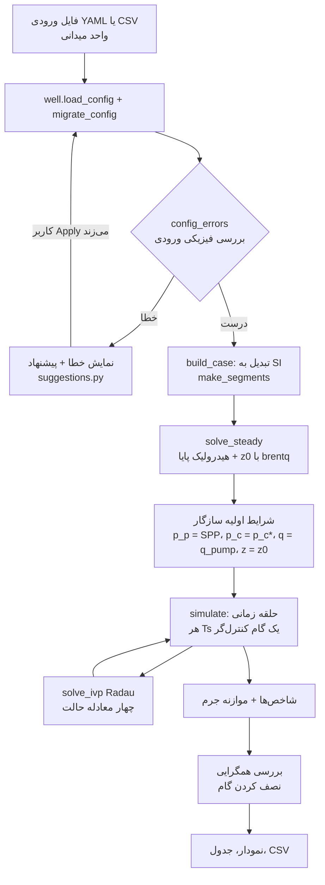
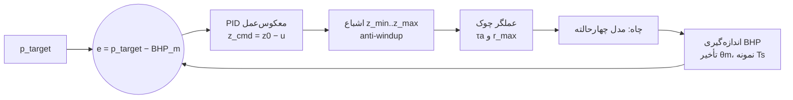

<!-- cSpell:disable -->
# مدل شبیه‌سازی هیدرولیک چاه برای حفاری با فشار مدیریت‌شده (MPD) و کنترل پویای فشار ته‌چاه

پایان‌نامه کارشناسی ارشد مهندسی نفت – گرایش حفاری، دانشگاه تهران.
**مرجع اصلی این نرم‌افزار، پروپوزال مصوب است.** هر جا مستندات قبلی با پروپوزال تفاوت داشت، پروپوزال ملاک قرار گرفته است.

> **هشدار:** همه داده‌های همراه برنامه **ساختگی (نمایشی)** هستند. اعتبارسنجی سطح ۱ با یک «محاسبه دستی ساختگی» انجام شده است و سطح ۲ و ۳ در وضعیت **«در انتظار داده مرجع»** هستند. این نرم‌افزار آموزشی/پژوهشی است و برای عملیات واقعی حفاری تأیید نشده است.

راهنمای لایه‌به‌لایه کد: `GUIDE_FA.md` – نسخه انگلیسی: `README.md`

---

## فهرست

1. [هدف و پرسش پژوهش](#۱-هدف-و-پرسش-پژوهش)
2. [نصب و اجرا](#۲-نصب-و-اجرا)
3. [فرضیات و دامنه مدل](#۳-فرضیات-و-دامنه-مدل)
4. [فلوچارت کلی برنامه](#۴-فلوچارت-کلی-برنامه)
5. [هیدرولیک پایا](#۵-هیدرولیک-پایا)
6. [مدل دینامیکی چهارحالته](#۶-مدل-دینامیکی-چهارحالته)
7. [چوک، عملگر، اندازه‌گیری و PID](#۷-چوک-عملگر-اندازهگیری-و-pid)
8. [سناریوهای S0 تا S5 و شاخص‌ها](#۸-سناریوهای-s0-تا-s5-و-شاخصها)
9. [نتایج روی چاه ساختگی](#۹-نتایج-روی-چاه-ساختگی)
10. [اعتبارسنجی سه‌سطحی](#۱۰-اعتبارسنجی-سهسطحی)
11. [صفحه‌های برنامه](#۱۱-صفحههای-برنامه)
12. [فرض‌ها و تصمیم‌های پیاده‌سازی](#۱۲-فرضها-و-تصمیمهای-پیادهسازی)
13. [محدودیت‌ها و منابع](#۱۳-محدودیتها-و-منابع)

---

## ۱. هدف و پرسش پژوهش

در MPD از نوع CBHP، فشار ته‌چاه (BHP) باید نزدیک فشار هدف و همیشه داخل پنجره امن بماند:

```
p_pore + δ  ≤  BHP  ≤  p_frac − δ          p_target = (p_pore + p_frac) / 2
```

مشکل اصلی در **گذارها** است (تغییر دبی پمپ و به‌ویژه **اتصال لوله**): با توقف پمپ، افت اصطکاکی فضای حلقوی حذف می‌شود و BHP افت می‌کند. چون سیال تراکم‌پذیر و جداره کشسان است، پاسخ فشار تأخیر دارد. این برنامه یک **مدل دینامیکی کم‌مرتبه چهارحالته**، یک **مدل فیزیکی چوک** با محدودیت‌های عملگر، و یک **کنترل‌گر PID معکوس‌عمل** را در یک چارچوب ترکیب می‌کند و آن‌ها را با شش سناریو و سه سطح اعتبارسنجی ارزیابی می‌کند.

## ۲. نصب و اجرا

```bash
# یک بار: محیط پایتون 3.12 (پایتون 3.9 اپل با Tk 8.5 روی macOS جدید از کار می‌افتد)
~/.local/share/uv/python/cpython-3.12-*/bin/python3.12 -m venv .venv
.venv/bin/pip install -r requirements.txt

.venv/bin/python app.py                                  # پنجره برنامه (۶ صفحه)
.venv/bin/python main.py                                 # حالت پایا + S0 تا S4 → پوشه outputs/
.venv/bin/python main.py --scenario all --s5 --validate  # همه چیز (حدود ۲ دقیقه)
.venv/bin/python main.py --scenario S3                   # یک سناریو
.venv/bin/python main.py --tune                          # مطالعه تنظیم PID روی S3
.venv/bin/python main.py --case data/case_library.csv --variant "OBM 10.5 ppg"
.venv/bin/pytest                                         # ۷۶ آزمون (حدود ۵۰ ثانیه)
```

برنامه **هیچ ورودی‌ای را خودبه‌خود تغییر نمی‌دهد**. اگر ورودی مشکل داشته باشد، خطا نشان داده می‌شود و «پیشنهاد» با توضیح «چرا» و «چطور روی دکل» ارائه می‌شود؛ فقط اگر کاربر دکمه «Apply» را بزند اعمال می‌شود.

## ۳. فرضیات و دامنه مدل

- جریان یک‌بعدی، تک‌فاز، سیال همگن؛ MPD از نوع CBHP با فشار هدف معلوم.
- رئولوژی Bingham Plastic با سه پارامتر ρ، μp، τy.
- هندسه قطعه‌ای و هم‌مرکز رشته و فضای حلقوی.
- مدل متمرکز: دو حجم (رشته و حلقوی) با سیال تراکم‌پذیر و جداره کشسان، یک اینرسی سیال، اصطکاک شبه‌پایا.
- **چوک تنها عملگر کنترلی است**؛ پمپ فشار برگشتی (BPP) یک **ورودی معلوم** است.
- خارج از دامنه: ورود سیال و هرزروی، کنده، دما، surge/swab، حرکت رشته، خروج از مرکز، Power-law و Herschel-Bulkley، چندفازی، MPC.

## ۴. فلوچارت کلی برنامه



حلقه کنترل در هر گام نمونه‌برداری:



## ۵. هیدرولیک پایا

مسیر جریان: پمپ ← رشته ← نازل‌های مته ← فضای حلقوی ← چوک (BPP در بالای فضای حلقوی دبی معلومی اضافه می‌کند).

| کمیت | رابطه |
|---|---|
| هیدرواستاتیک | `P = ρ g h` (عمق قائم TVD) |
| سرعت بحرانی رشته | `v_c = (97μp + 97√(μp² + 8.2 ρ d² τy)) / (ρ d)`  [ft/min] |
| سرعت بحرانی حلقوی | همان رابطه با 6.2 و `Δd = d_h − d_o` |
| آرام (رشته / حلقوی) | `μp v/(1500 d²) + τy/(225 d)`  /  `μp v/(1000 Δd²) + τy/(200 Δd)`  [psi/ft، v بر حسب ft/s] |
| آشفته (رشته / حلقوی) | `ρ^0.75 v^1.75 μp^0.25 / (1800 d^1.25)`  /  `... / (1396 Δd^1.25)` |
| هموارسازی | هر افت × `tanh(q/q_ε)`، `q_ε = 10⁻⁴ × دبی کاری` |
| مته | `ΔP_bit = ρ q² / (2 C_dn² A_n²)` |
| فشار ته‌چاه | `BHP = p_c + ρ g h + ΔP_a` |
| فشار استندپایپ | `SPP = p_c + ΔP_d + ΔP_bit + (ρa − ρd) g h + ΔP_a` |
| ECD | `ECD = BHP / (g h)` (و برای مقایسه: ECD بدون p_c = ρ + ΔP_a/(g h)) |
| بازشدگی اولیه | `p_c* = p_target − ρ g h − ΔP_a`، سپس z0 از معادله چوک با `brentq` |

مدل اصطکاک پیش‌فرض همان روابط پروپوزال (Bourgoyne / API RP 13D) است. حل دقیق بینگهام (Buckingham-Reiner و شکاف باریک) فقط به‌عنوان **مدل مقایسه‌ای** با نام `exact_bingham` نگه داشته شده است.

## ۶. مدل دینامیکی چهارحالته

چهار متغیر حالت: فشار استندپایپ `p_p`، فشار پشت چوک `p_c`، دبی رشته و مته `q`، بازشدگی چوک `z`:

```
(V_d / β_eff) dp_p/dt = q_pump − q                                         (1)
(V_a / β_eff) dp_c/dt = q + q_bpp − q_c                                    (2)
M dq/dt = p_p − p_c − (ρa − ρd) g h − ΔP_d − ΔP_bit − ΔP_a                 (3)
dz/dt  = r_max tanh( ((z_cmd − z)/τa) / r_max )   سپس z در [z_min, z_max]   (4)

V_d = Σ A_i L_i      V_a = Σ A_a,i L_i      M = Σ ρL_i/A_i + Σ ρL_i/A_a,i
1/β_eff = 1/β_f + 1/β_w          (جداره نازک: β_w ≈ 2 E t / D)
```

- **حل‌کننده:** `scipy.integrate.solve_ivp` با روش **Radau** (دستگاه سخت است)، rtol = 1e-6 و atol = 1e-9. روش‌های RK45، BDF و LSODA برای مقایسه قابل انتخاب‌اند.
- **موازنه جرم:** یک متغیر پنجم (فقط برای حسابرسی) انتگرال `q_pump + q_bpp − q_c` را نگه می‌دارد و در هر لحظه با `(V_d/β)Δp_p + (V_a/β)Δp_c` مقایسه می‌شود. باقیمانده در همه اجراها حدود 1e-15 درصد است.
- **همگرایی:** اجرا با نصف گام حداکثر تکرار می‌شود و تغییر نسبی RMSE فشار ته‌چاه باید کمتر از ۰٫۱٪ باشد؛ در غیر این صورت هشدار داده می‌شود.
- **شرایط اولیه** همیشه نقطه کار پایا است (همه مشتق‌ها در آن صفر هستند).

## ۷. چوک، عملگر، اندازه‌گیری و PID

```
q_c = C_d A_c(z) √(2 Δp⁺ / ρ)       Δp = p_c − p_0      Δp⁺ = (Δp + √(Δp² + ε²)) / 2,  ε = 10⁻³ × بیشینه فشار کاری
A_c(z) = A_max z            (خطی، مدل پایه)
A_c(z) = A_max R^(z−1)      (هم‌درصد، فقط در سناریوی حساسیت)
BHP_m(t) = BHP(t − θm)      هر Ts ثانیه نمونه‌برداری، بین دو نمونه ثابت (نگهدارنده مرتبه صفر)، نویز خاموش
e = p_target − BHP_m        z_cmd = z0 − (Kp e + Ki ∫e dt + Kd de/dt)
```

- **معکوس‌عمل:** اگر BHP کمتر از هدف باشد، e مثبت است و چوک **بسته** می‌شود.
- **فیلتر مشتق:** ثابت زمانی `T_f = (Kd/Kp)/N` با N = 8.
- **ضد انباشت back-calculation:** `dI/dt = Ki e + (u_sat − u)/T_t`، که در آن T_t = Ti = Kp/Ki است.
- جمله‌های P، I و D و فرمان اشباع‌شده و اشباع‌نشده در نمودار «Controller terms» نشان داده می‌شوند.

**تنظیم ضرایب (روی S3، با دستور `main.py --tune`):**

1. Ki و Kd صفر؛ Kp از 0.005 تا 0.32 افزایش داده شد. بزرگ‌ترین Kp بدون نوسان مشخص برابر **0.08 بر بار** است (با 0.16 چوک ۳۸ بار تغییر جهت می‌دهد).
2. Ki از 0.001 تا 0.032 آزموده شد. کمترین RMSE بدون نوسان در **Ki = 0.008** به دست آمد.
3. فراجهش PI برابر ۱٫۱۳٪ و کمتر از ۵٪ است، پس طبق قاعده پروپوزال **Kd = 0**.

نتیجه این است که اجرای PID در S4 با PI یکسان است. اگر استاد راهنما PID متمایز بخواهد، Kd = 0.05 RMSE را حدود ۱۳٪ کم می‌کند.

## ۸. سناریوهای S0 تا S5 و شاخص‌ها

همه زمان‌بندی‌ها در `config/scenarios.yaml` هستند و از صفحه «Control & Scenarios» هم قابل ویرایش‌اند.

| سناریو | شرح |
|---|---|
| S0 | حالت پایا در ۳۵۰، ۵۰۰ و ۶۵۰ gpm؛ مدل دینامیکی هم از هر نقطه شروع می‌شود و باید ثابت بماند |
| S1 | پله دبی پمپ از ۵۰۰ به ۶۵۰ gpm با چوک ثابت (پاسخ BHP و SPP) |
| S2 | پله فرمان چوک (۰٫۰۵ بسته‌تر) بدون کنترل‌گر. دلیل: بدون کنترل‌گر، پله فشار هدف اثری ندارد. نسخه پله هدف با PID در S2b آمده است |
| S3 | اتصال لوله بدون کنترل‌گر: پمپ بین t1 = 30 و t2 = 90 ثانیه به صفر می‌رسد، تا t3 = 270 صفر می‌ماند و تا t4 = 330 به q0 برمی‌گردد. هم‌زمان BPP تا ۲۰۰ gpm بالا می‌رود (فرض) |
| S4 | همان اتصال با چوک ثابت، P، PI و PID (اغتشاش و شرایط اولیه یکسان) |
| S5 | اجرای PID سناریوی S4 با ±۲۰٪ تغییر در β_eff، τy، μp، C_d و A_max (ضرایب ثابت) و چوک هم‌درصد |

**شاخص‌ها:**

- فراجهش: برای پله هدف، درصدی از اندازه پله؛ برای اغتشاش، بیشینه انحراف تقسیم بر هدف.
- زمان نشست در باند ±۲٪ هدف.
- بیشینه انحراف، RMSE و MAPE.
- درصد زمان داخل پنجره امن.

**معیارهای مقدماتی پروپوزال:** فراجهش کمتر از ۵٪، زمان نشست کمتر از ۶۰ ثانیه، و حداقل ۹۵٪ زمان داخل پنجره. این‌ها «هدف» هستند نه «نتیجه تضمین‌شده»، و برای هر اجرا با PASS یا FAIL نشان داده می‌شوند.

## ۹. نتایج روی چاه ساختگی

**مشخصات چاه پایه:** چاه J، عمق ۳۵۰۰ متر MD و ۲۹۴۳ متر TVD، گل ۱۰ ppg و دبی ۵۰۰ gpm.

| کمیت | مقدار |
|---|---|
| BHP و هدف | ۳۸۳٫۸ بار (۱۱٫۱۰ ppg، وسط پنجره) |
| SPP | ۱۷۶٫۱ بار |
| فشار چوک p_c | ۱۴٫۴ بار |
| بازشدگی اولیه z0 | ۰٫۴۵۴ |
| افت لوله حفاری | ۵۴٫۸ بار |
| افت BHA | ۲۴٫۳ بار |
| افت مته | ۵۹٫۰ بار |
| افت حلقوی | ۲۳٫۷ بار |
| β_eff | ۱٫۴۴ گیگاپاسکال |
| V_d و V_a | ۳۱٫۴ و ۸۴٫۹ مترمکعب |

| سناریو | نتیجه |
|---|---|
| S0 | z0 برابر ۰٫۳۰ / ۰٫۴۵ / ۰٫۷۵ و SPP برابر ۱۰۹ / ۱۷۶ / ۲۶۳ بار؛ مدل دینامیکی بدون هیچ رانشی ثابت ماند |
| S1 | BHP ۱۵٫۵ بار بالا رفت و در حالت پایای جدید نشست (حلقه باز، پس معیار نشست FAIL است) |
| S2 | با بستن ۰٫۰۵ چوک، BHP ۳٫۸ بار بالا رفت |
| S3 | BHP ۲۰٫۹ بار افت کرد و فقط ۶۰٪ زمان داخل پنجره امن ماند (هر سه معیار FAIL) |
| S4 | P: بیشینه انحراف ۶٫۹ بار؛ PI و PID: ۴٫۳ بار، RMSE ۰٫۶۰ بار، فراجهش ۱٫۱۳٪ و ۱۰۰٪ داخل پنجره (هر سه معیار PASS) |
| S5 | بیشینه انحراف بین ۳٫۴ تا ۵٫۷ بار؛ حساس‌ترین پارامتر β_eff است. C_d و A_max اثر یکسان دارند، چون در چوک خطی فقط حاصل‌ضرب آن‌ها مهم است |

## ۱۰. اعتبارسنجی سه‌سطحی

هر جدول این ستون‌ها را دارد: کمیت، واحد، مقدار مدل، مقدار مرجع، خطای مطلق، خطای درصدی، نوع داده و منبع.

| سطح | آزمون | وضعیت |
|---|---|---|
| ۱ – کد و معادله | محاسبه دستی مستقل (`data/hand_calculation.py`)، قاعده 0.052، معکوس معادله چوک، صفر بودن مشتق‌ها در نقطه پایا، موازنه جرم، نصف کردن گام | بیشینه خطا ۰٫۰۹۳٪ (فقط به خاطر گرد شدن ثابت‌های میدانی) – **داده ساختگی** |
| ۲ – هیدرولیک پایا در برابر مثال منتشرشده | MAPE کمتر از ۵٪ | **در انتظار داده مرجع**: یک مثال حل‌شده کتاب یا داده منتشرشده باید با ذکر منبع در `data/reference/steady_reference.csv` قرار گیرد |
| ۳ – شکل پاسخ گذرا (Kaasa 2012، Naderi Lordejani 2020) | شکل پاسخ، فراجهش و زمان نشست | **در انتظار داده مرجع**: منحنی‌ها باید دیجیتال شوند و با شماره شکل و منبع ذخیره شوند. تا آن زمان فقط مقایسه کیفی ممکن است |

هیچ عددی برای سطح ۲ و ۳ ساخته نشده است. قالب فایل‌ها در `data/reference/README.md` آمده است.

## ۱۱. صفحه‌های برنامه

| صفحه | محتوا |
|---|---|
| 1 Project & Case | ورودی‌های کلیدی، دامنه و فرضیات، فایل کامل YAML، کتابخانه CSV، بررسی ورودی و پیشنهادها (Apply) |
| 2 Steady Hydraulics | فشار ته‌چاه، SPP، p_c و ECD، نوار پنجره فشار، پروفایل فشار بر حسب MD و TVD، نمودار آبشاری مسیر فشار، جدول قطعه‌ها و رژیم جریان، مسیر چاه |
| 3 Dynamic Model | انتخاب سناریو، کنترل‌گر و حل‌کننده؛ موازنه جرم، همگرایی؛ نمودار کلی، چهار حالت، افت‌ها و ECD، پروفایل عمقی، داده |
| 4 Control & Scenarios | سناریوهای S0 تا S4 با زمان‌بندی قابل ویرایش، مقایسه چوک ثابت / P / PI / PID، کارت‌های معیار (PASS/FAIL)، جمله‌های کنترل‌گر، مطالعه تنظیم PID |
| 5 Sensitivity | S5 (نمودار تورنادو انحراف و منحنی‌ها) و حساسیت پایا (تورنادو و جاروب) |
| 6 Validation & Evidence | سه سطح با برچسب وضعیت، جدول‌ها، نمودار، مقایسه مدل‌ها و منابع |

محاسبات طولانی در پس‌زمینه اجرا می‌شوند و نوار پیشرفت و دکمه Cancel در پایین پنجره هست. همه جدول‌ها قابل خروجی CSV هستند. پنجره در اندازه حداقل ۱۲۰۰×۷۶۰ و اندازه معمول ارائه ۱۴۸۰×۹۴۰ بررسی شده است.

## ۱۲. فرض‌ها و تصمیم‌های پیاده‌سازی

1. **واحد سرعت در روابط اصطکاک:** متن پروپوزال برای همه روابط ft/min نوشته است، اما ثابت‌های 1500، 225 و 1800 (و 1000، 200 و 1396) مربوط به فرم Bourgoyne با سرعت بر حسب **ft/s** هستند. اگر ft/min به کار رود، اصطکاک حدود ۶۰ برابر بیش از حد می‌شود. در برنامه، v_c بر حسب ft/min و گرادیان‌ها با v بر حسب ft/s محاسبه می‌شوند. **این مورد نیاز به تأیید استاد راهنما دارد.**
2. **گذر آرام به آشفته** به‌صورت خطی در بازه v_c تا 1.1 v_c انجام می‌شود. در لوله حفاری پایه، اصطکاک آشفته در v_c حدود ۳۹٪ بیشتر از آرام است و این پرش، حل‌کننده را دقیقاً روی v_c گیر می‌اندازد. این همان ایده هموارسازی tanh پروپوزال است و با `regime_transition_width` قابل تنظیم است (مقدار ۰ یعنی پرش ساده).
3. در رابطه BHP پروپوزال «ΔP_c» آمده است که به‌عنوان افت حلقوی ΔP_a تفسیر شد.
4. یک گل واحد در رشته و حلقوی جریان دارد (ρa = ρd)، پس جمله هیدرواستاتیک SPP صفر است.
5. معکوس معادله چوک به p_c ≥ p_0 − ε محدود شده است، چون Δp⁺ هموار هرگز دبی دقیقاً صفر نمی‌دهد.
6. β_w = 3.4e10 پاسکال از رابطه 2Et/D (فولاد ۲۰۰ گیگاپاسکال، لوله ۵ اینچ) و β_f = 1.5e9 پاسکال گرفته شد. منبع این مقادیر باید تأیید شود.
7. مقادیر Ts = 0.2 s، θm = 0.5 s، τa = 1 s، r_max = 0.05 بر ثانیه، A_max = 3.14 in² و C_d = 0.7 ساختگی هستند و باید تأیید شوند.
8. در اتصال لوله، BPP تا ۲۰۰ gpm بالا می‌رود. در دبی صفر پمپ، نگه داشتن هدف با این BPP به z ≈ 0.11 نیاز دارد که داخل بازه مجاز است.
9. فراجهش اغتشاش برابر بیشینه انحراف تقسیم بر هدف تعریف شد، چون «فاصله اولیه» وقتی BHP روی هدف شروع می‌شود صفر است.
10. «نوسان مشخص» در تنظیم PID یعنی بیش از ۶ بار عبور BHP از هدف (با باند ۰٫۱٪) یا بیش از ۲۰ بار تغییر جهت چوک.
11. در بررسی همگرایی، گام حداکثر انتگرال‌گیر نصف می‌شود و Ts ثابت می‌ماند، چون Ts جزء کنترل‌گر است نه روش عددی.

**تعارض با نسخه قبلی:** نسخه قبلی این اجزا را داشت:

- اصطکاک دقیق بینگهام (اکنون فقط مدل مقایسه‌ای است)
- منحنی Cv برای چوک
- مدل یک‌حالته حلقوی با گام اویلر دستی
- عملگر فشار برگشتی و حالت SBP ثابت
- مقاومت ژل
- surge/swab درون مدل اصلی
- اصلاح خودکار بی‌صدای ورودی‌ها

همه این‌ها مطابق پروپوزال جایگزین شدند. surge/swab فقط در `mpd/extensions.py` و با برچسب «خارج از دامنه» باقی مانده است. فایل‌های ورودی قدیمی با `migrate_config` تبدیل می‌شوند.

## ۱۳. محدودیت‌ها و منابع

- مدل متمرکز است و امواج فشاری را نشان نمی‌دهد (برای این اثرات رجوع شود به روش Godunov در مرجع ۴).
- اصطکاک شبه‌پایا است.
- مدل تک‌فاز است؛ ورود سیال، هرزروی، کنده و ژل در نظر گرفته نشده‌اند.
- چوک تنها عملگر است.
- همه داده‌ها ساختگی هستند و اعتبارسنجی کمی سطح ۲ و ۳ هنوز انجام نشده است.

منابع:

1. Kaasa et al., SPE Drilling & Completion 27(1), 2012, doi:10.2118/143097-PA
2. Naderi Lordejani et al., SPE Drilling & Completion 35(4), 2020, doi:10.2118/201108-PA
3. Sheikhi et al., ISA Transactions, 2022, doi:10.1016/j.isatra.2021.11.022
4. Sánchez-Barra et al., J. Petrol. Explor. Prod. Technol., 2015, doi:10.1007/s13202-015-0176-8
5. Bourgoyne et al., Applied Drilling Engineering, SPE, 1986
6. Åström & Hägglund, Advanced PID Control, ISA, 2006
