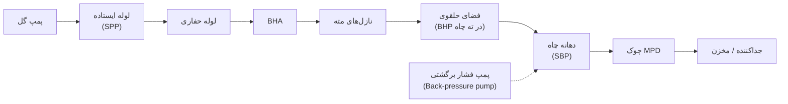
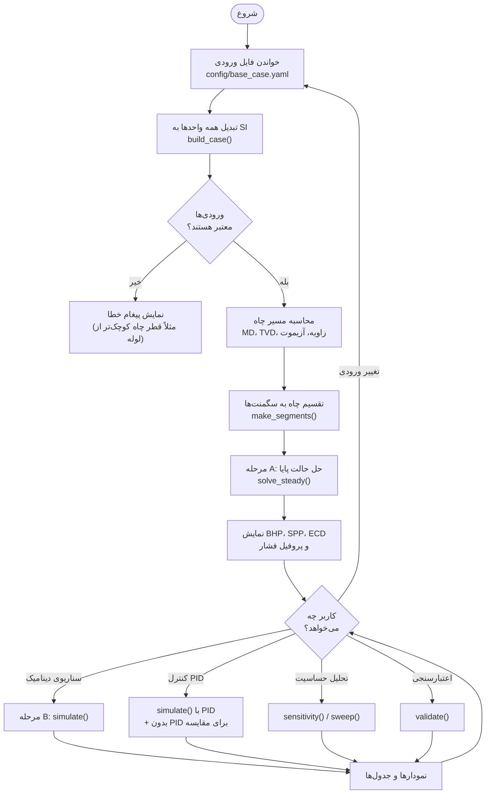
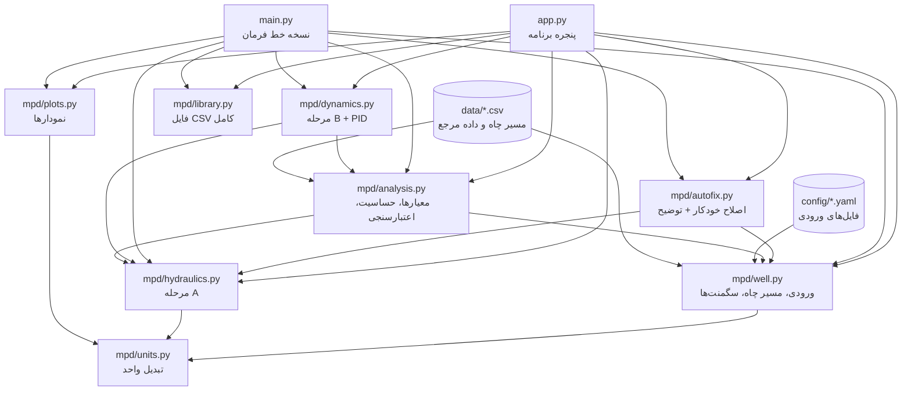
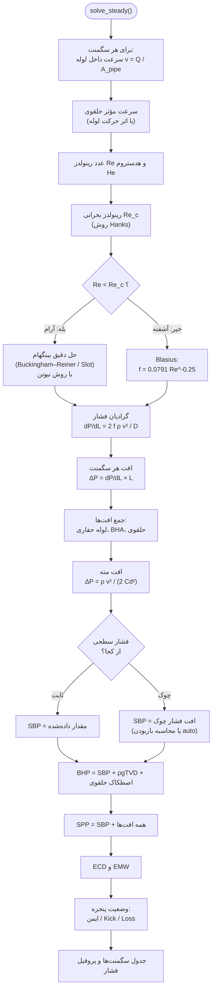
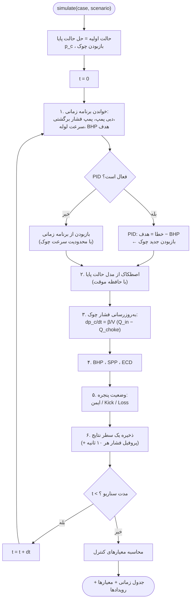
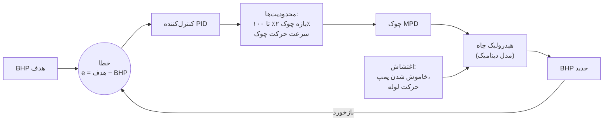
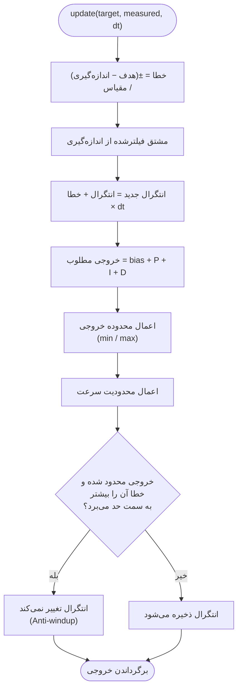
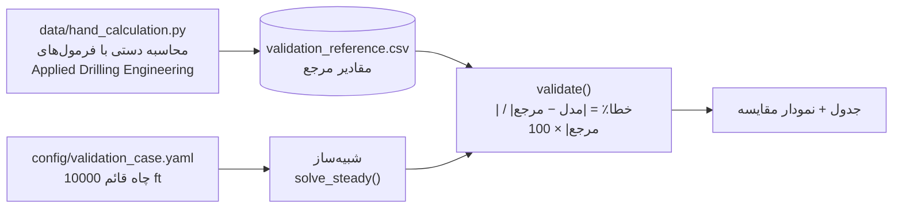
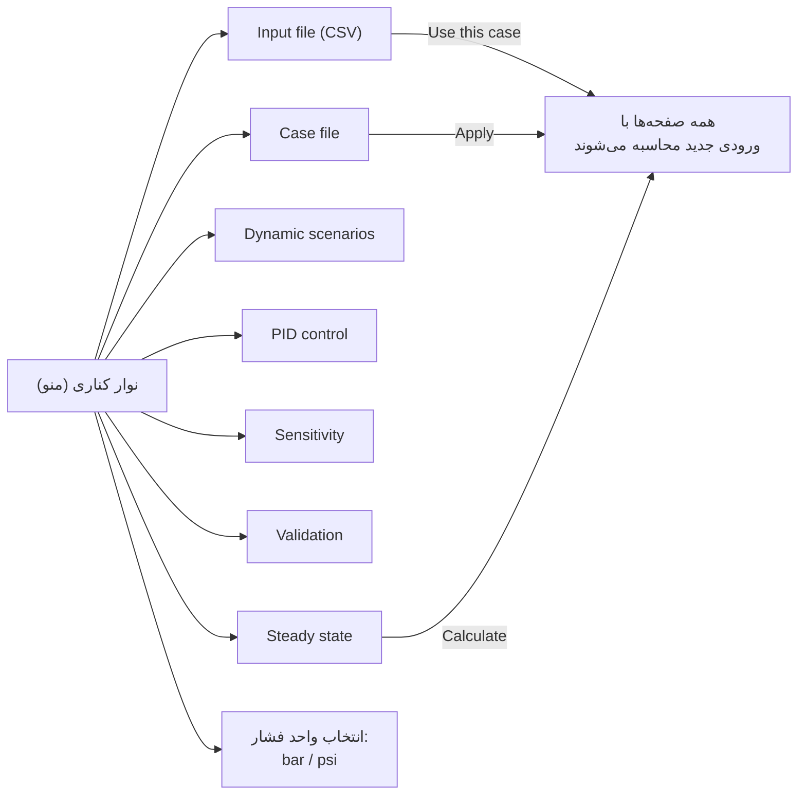
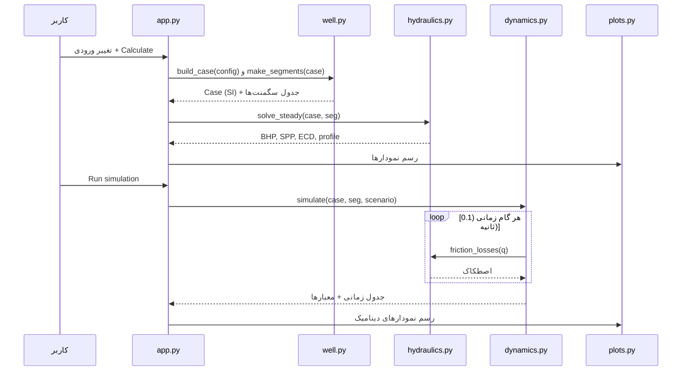

<!-- cSpell:disable -->
# شبیه‌ساز هیدرولیک چاه برای حفاری با فشار مدیریت‌شده (MPD) و کنترل دینامیک فشار ته چاه

**پروژه پایان‌نامه کارشناسی ارشد – دانشگاه تهران – زبان برنامه‌نویسی: Python**

> **راهنمای لایه‌به‌لایه کد** (هر فایل و هر تابع، از بیرون به درون): [`GUIDE_FA.md`](GUIDE_FA.md)

> **توجه:** این نرم‌افزار برای پژوهش و آموزش ساخته شده و برای عملیات واقعی حفاری تأیید نشده است. همه داده‌های داخل پروژه **داده‌های ساختگی (نمایشی)** هستند و از چاه واقعی یا آزمایشگاه به دست نیامده‌اند.

---

## فهرست مطالب

1. [هدف پروژه](#۱-هدف-پروژه)
2. [MPD چیست؟](#۲-mpd-چیست)
3. [نمای کلی برنامه و فلوچارت اصلی](#۳-نمای-کلی-برنامه-و-فلوچارت-اصلی)
4. [ساختار فایل‌ها](#۴-ساختار-فایلها)
5. [نصب و اجرا](#۵-نصب-و-اجرا)
6. [فایل ورودی (Case file)](#۶-فایل-ورودی-case-file)
7. [مرحله A: هیدرولیک حالت پایا](#۷-مرحله-a-هیدرولیک-حالت-پایا)
8. [مرحله B: شبیه‌سازی دینامیک](#۸-مرحله-b-شبیهسازی-دینامیک)
9. [کنترل‌کننده PID](#۹-کنترلکننده-pid)
10. [پنجره فشار و معیارهای کنترل](#۱۰-پنجره-فشار-و-معیارهای-کنترل)
11. [سناریوهای دینامیک](#۱۱-سناریوهای-دینامیک)
12. [تحلیل حساسیت](#۱۲-تحلیل-حساسیت)
13. [اعتبارسنجی](#۱۳-اعتبارسنجی)
14. [راهنمای صفحه‌های برنامه](#۱۴-راهنمای-صفحههای-برنامه)
15. [توضیح کد، فایل به فایل](#۱۵-توضیح-کد-فایل-به-فایل)
16. [تست‌ها](#۱۶-تستها)
17. [فرضیات، محدودیت‌ها و کارهای آینده](#۱۷-فرضیات-محدودیتها-و-کارهای-آینده)
18. [پیشنهاد برای ارائه](#۱۸-پیشنهاد-برای-ارائه)
19. [واژه‌نامه](#۱۹-واژهنامه)
20. [منابع](#۲۰-منابع)

---

## ۱. هدف پروژه

هدف، ساخت یک **مدل شبیه‌سازی هیدرولیک چاه** برای سیستم‌های MPD است که در دو مرحله کار می‌کند.

| مرحله | کار | خروجی‌ها |
|---|---|---|
| **مرحله A – حالت پایا (Steady state)** | محاسبه فشار در تمام نقاط چاه، وقتی گل با دبی ثابت در گردش است | افت فشار در لوله حفاری، BHA، مته و فضای حلقوی؛ فشار هیدرواستاتیک؛ SPP؛ BHP؛ ECD؛ پروفیل فشار بر حسب عمق |
| **مرحله B – دینامیک (Dynamic)** | شبیه‌سازی چاه در طول زمان: روشن و خاموش شدن پمپ، تغییر چوک، حرکت لوله | نمودارهای (BHP(t، (SPP(t، (ECD(t؛ موقعیت چوک؛ وضعیت پنجره فشار |
| **کنترل حلقه بسته** | ثابت نگه داشتن فشار ته چاه با کنترل‌کننده **PID** که چوک را باز و بسته می‌کند | زمان نشست، فراجهش، خطای ماندگار، زمان خروج از پنجره |

**مدل رئولوژی:** طبق پروپوزال پایان‌نامه، مدل **بینگهام پلاستیک (Bingham Plastic)** است:

$$\tau = \tau_y + \mu_p \, \dot{\gamma}$$

| نماد | معنی | واحد |
|---|---|---|
| τ | تنش برشی | Pa |
| τ_y | تنش تسلیم (Yield Point, YP) | Pa |
| μ_p | ویسکوزیته پلاستیک (Plastic Viscosity, PV) | Pa·s |
| γ̇ | نرخ برش | 1/s |

---

## ۲. MPD چیست؟

در **حفاری معمولی** دهانه فضای حلقوی به هوا باز است، پس:

$$BHP = \rho g \, TVD + \Delta P_{\text{annulus friction}}$$

وقتی پمپ خاموش می‌شود (مثلاً هنگام اضافه کردن لوله، Connection)، افت اصطکاکی صفر می‌شود و **فشار ته چاه ناگهان کم می‌شود**. اگر BHP از **فشار منفذی (Pore pressure)** کمتر شود، سیال سازند وارد چاه می‌شود، که به آن **Kick** می‌گویند. اگر BHP از **فشار شکست (Fracture pressure)** بیشتر شود، سازند می‌شکند و گل از دست می‌رود، که به آن **Loss** می‌گویند.

در **MPD** دهانه چاه بسته است و گل از یک **چوک (Choke)** عبور می‌کند. با تنظیم چوک یک **فشار سطحی (SBP – Surface Back Pressure)** اعمال می‌شود:

$$BHP = SBP + \rho g \, TVD + \Delta P_{\text{annulus friction}}$$

پس وقتی اصطکاک کم می‌شود، می‌توان SBP را زیاد کرد تا BHP ثابت بماند. این دقیقاً کاری است که **کنترل‌کننده PID** در این پروژه انجام می‌دهد.



---

## ۳. نمای کلی برنامه و فلوچارت اصلی

### ۳-۱. فلوچارت کلی برنامه



### ۳-۲. همان فلوچارت به صورت متنی (برای نمایشگرهایی که Mermaid ندارند)

```
            ┌──────────────────────────────┐
            │ خواندن فایل ورودی (YAML)     │
            └──────────────┬───────────────┘
                           ▼
            ┌──────────────────────────────┐
            │ تبدیل واحدها به SI + بررسی   │──خطا──► پیغام خطا
            └──────────────┬───────────────┘
                           ▼
            ┌──────────────────────────────┐
            │ مسیر چاه (MD/TVD) + سگمنت‌ها │
            └──────────────┬───────────────┘
                           ▼
            ┌──────────────────────────────┐
            │ مرحله A: حالت پایا           │
            │ BHP, SPP, ECD, پروفیل فشار   │
            └──────────────┬───────────────┘
                           ▼
     ┌──────────────┬──────┴───────┬──────────────┐
     ▼              ▼              ▼              ▼
 سناریوی دینامیک  کنترل PID   تحلیل حساسیت   اعتبارسنجی
 (مرحله B)       (مرحله B)
     └──────────────┴──────┬───────┴──────────────┘
                           ▼
                 نمودار، جدول، فایل CSV
```

### ۳-۳. ارتباط بین فایل‌های کد



---

## ۴. ساختار فایل‌ها

```
sepehr-py/
├── app.py                    پنجره برنامه (Tkinter + matplotlib)
├── main.py                   نسخه خط فرمان (خروجی CSV و PNG)
├── config/
│   ├── base_case.yaml        مشخصات چاه، گل، عملیات، چوک، PID
│   ├── scenarios.yaml        ۱۰ سناریوی دینامیک
│   └── validation_case.yaml  چاه قائم ساده برای اعتبارسنجی
├── data/
│   ├── trajectory_example.csv     داده مسیر چاه (Survey) – ساختگی
│   ├── case_library.csv           فایل CSV کامل نمونه (همه ورودی‌ها، ۱۰ حالت) – ساختگی
│   ├── hand_calculation.py        محاسبه دستی مستقل (فرمول‌های کتاب)
│   └── validation_reference.csv   نتایج محاسبه دستی = مقادیر مرجع
├── mpd/                      هسته محاسباتی
│   ├── units.py              تبدیل واحدها
│   ├── well.py               خواندن ورودی، مسیر چاه، سگمنت‌بندی
│   ├── library.py            فایل CSV کامل: خواندن، نوشتن، چند حالت کنار هم
│   ├── autofix.py            اصلاح خودکار هدف و نتیجه، با توضیح چرا و چطور
│   ├── hydraulics.py         مرحله A (اصطکاک بینگهام، مته، چوک، BHP/SPP/ECD)
│   ├── dynamics.py           مرحله B (شبیه‌سازی زمانی + PID)
│   ├── analysis.py           معیارهای کنترل، حساسیت، اعتبارسنجی
│   └── plots.py              همه نمودارها
├── tests/                    ۴۲ تست خودکار
├── outputs/                  خروجی‌های main.py (ساخته می‌شود)
├── GUIDE_FA.md               راهنمای لایه‌به‌لایه کد
└── README_FA.md              همین فایل
```

حجم کد حدود ۲٬۶۰۰ خط است و بیشتر آن تابع‌های ساده با توضیح است.

---

## ۵. نصب و اجرا

```bash
# یک بار: ساخت محیط و نصب کتابخانه‌ها
python3 -m venv .venv
.venv/bin/pip install -r requirements.txt

# اجرای پنجره برنامه
.venv/bin/python app.py

# اجرای نسخه خط فرمان (همه سناریوها + حساسیت + اعتبارسنجی)
.venv/bin/python main.py --sensitivity --validate

# فقط یک سناریو
.venv/bin/python main.py --scenario pid_control

# اجرا با فایل CSV کامل (یک حالت از آن)
.venv/bin/python main.py --case data/case_library.csv --variant "OBM 11.0 ppg"

# اجرای تست‌ها
.venv/bin/pytest
```

**کتابخانه‌ها:** numpy، pandas، scipy، matplotlib، pyyaml، pytest. **Tkinter** همراه خود پایتون نصب می‌شود.

> روی نسخه‌های جدید macOS، پایتون پیش‌فرض اپل (3.9) کتابخانه Tk قدیمی دارد و پنجره برنامه را می‌بندد. این پروژه از **Python 3.12** استفاده می‌کند که با ابزار `uv` نصب شده است. روی ویندوز، پایتون سایت python.org مشکلی ندارد.

---

## ۶. فایل ورودی (Case file)

همه ورودی‌ها در `config/base_case.yaml` هستند. **واحد هر عدد در نام آن نوشته شده است**، مثلاً `density_ppg` یا `length_m`. برنامه هنگام خواندن فایل همه را **یک بار** به SI تبدیل می‌کند و تمام محاسبات در SI انجام می‌شود.

| بخش | مثال | توضیح |
|---|---|---|
| `well.survey_file` | `data/trajectory_example.csv` | مسیر چاه: MD، TVD، زاویه انحراف، آزیموت |
| `well.hole_sections` | کیسینگ "8.681، حفره باز "8.5 | قطر چاه از سطح تا ته |
| `well.drill_string` | لوله حفاری "5 و BHA "6.5 | از سطح تا مته؛ مجموع طول = عمق مته |
| `well.bit` | چهار نازل 13/32 اینچ، Cd = 0.95 | مشخصات مته |
| `mud` | 10 ppg، PV = 20 cP، YP = 15 lbf/100ft² | خواص گل بینگهام |
| `operation` | 500 gpm، چوک auto | نقطه کاری |
| `pressure_window` | منفذی 10.4، شکست 11.8، هدف 11.0 ppg | پنجره فشار در ته چاه |
| `choke` | Cv_max = 100 | منحنی خطی چوک |
| `dynamics` | dt = 0.1 s، β = 1.5e9 Pa | تنظیمات مدل دینامیک |
| `pid` | Kp = 0.1، Ki = 0.05 | ضرایب کنترل‌کننده |
| `numerics` | طول سگمنت 30 m | دقت محاسبات |

**`choke_opening: auto`** یعنی برنامه خودش درصد بازبودن چوک را طوری پیدا می‌کند که BHP دقیقاً برابر هدف شود. برای این کار چوک را با روش **دوبخشی (Bisection)** وارونه حل می‌کند.

**بررسی ورودی‌ها:** تابع `check_case` این خطاها را تشخیص می‌دهد:

- چگالی یا PV غیرمثبت، یا دبی منفی
- MD نزولی، یا TVD بزرگ‌تر از MD
- رشته حفاری بلندتر از چاه
- قطر داخلی (ID) لوله بزرگ‌تر از قطر خارجی (OD)
- قطر چاه کوچک‌تر از OD لوله
- فشار هدف خارج از پنجره فشار

**فایل CSV کامل:** همه ورودی‌ها (مسیر چاه، حفره، رشته حفاری، مته، گل، عملیات، پنجره، چوک، دینامیک، PID، عددی) را می‌توان در **یک فایل CSV** گذاشت (`data/case_library.csv` نمونه است). هر ردیف یک ورودی است (`mud.density_ppg`) و هر ستون یک حالت (مثلاً یک گل)؛ حالت اول باید کامل باشد و در بقیه خانه خالی یعنی «مثل حالت اول». جزئیات در `GUIDE_FA.md` بخش ۲-۱.

**اصلاح خودکار (Auto-fix):** بعد از هر تغییر ورودی، `mpd/autofix.py` بررسی می‌کند که هدف و BHP داخل پنجره امن باشند (با حاشیه `warning_margin_psi`) و با چوک خودکار BHP برابر هدف شود. اگر نباشد، علت را پیدا می‌کند (فشار سطحی، چوک، جریان چوک، وزن گل یا اصطکاک)، کوچک‌ترین اصلاح را انجام می‌دهد و در نوار زرد می‌نویسد: مشکل، چرا، چه شد، و روی دکل چه باید کرد. جزئیات در `GUIDE_FA.md` بخش ۲-۲.

---

## ۷. مرحله A: هیدرولیک حالت پایا

### ۷-۱. فلوچارت محاسبه حالت پایا



### ۷-۲. مسیر چاه: روش حداقل انحنا (Minimum Curvature)

| کمیت | کاربرد |
|---|---|
| **MD** (عمق اندازه‌گیری‌شده) | طول واقعی مسیر؛ برای **اصطکاک** |
| **TVD** (عمق قائم واقعی) | فقط برای **فشار هیدرواستاتیک** |

$$\cos\beta = \cos(I_2 - I_1) - \sin I_1 \sin I_2 \,(1 - \cos(A_2 - A_1))$$

$$RF = \frac{2}{\beta}\tan\frac{\beta}{2}, \qquad \Delta TVD = \frac{\Delta MD}{2}(\cos I_1 + \cos I_2) \, RF$$

در این روابط I زاویه انحراف (Inclination) و A آزیموت (Azimuth) است.

### ۷-۳. سگمنت‌بندی

تابع `make_segments` چاه را از سطح تا مته به قطعه‌هایی با طول حدود ۳۰ متر تقسیم می‌کند. هر جا که قطر لوله یا چاه تغییر کند (مثلاً ابتدای BHA یا کفشک کیسینگ)، یک مرز سگمنت قرار داده می‌شود.

**هر سطر جدول = یک سگمنت** با این ستون‌ها:

- MD بالا و پایین، TVD، زاویه انحراف، آزیموت، طول
- نام و نوع لوله، ID و OD لوله، قطر چاه

در حالت پایه چاه به **۱۱۷ سگمنت** تقسیم می‌شود.

### ۷-۴. هندسه

| رابطه | فرمول |
|---|---|
| سطح داخل لوله | A = πD²/4 |
| سطح فضای حلقوی | A = π/4 (D_hole² − D_pipe²) |
| قطر هیدرولیکی حلقوی | D_h = D_hole − D_pipe |
| سرعت متوسط | v = Q/A |

### ۷-۵. اصطکاک سیال بینگهام

| گام | رابطه | منبع |
|---|---|---|
| ۱ – عدد رینولدز | Re = ρ\|v\|D/μ_p | استاندارد |
| ۲ – عدد هدستروم | He = ρ τ_y D² / μ_p² | Hedström 1952 |
| ۳ – رینولدز بحرانی | x/(1−x)³ = He/16800 ، Re_c = He/(8x)·(1 − 4x/3 + x⁴/3) | Hanks 1963 |
| ۴ – آرام، داخل لوله | 8 μ_p v / D = τ_w (1 − 4r/3 + r⁴/3) ، r = τ_y/τ_w | Buckingham–Reiner |
| ۴ – آرام، حلقوی | 12 μ_p v / D_h = τ_w (1 − 3r/2 + r³/2) | مدل شکاف (Slot) |
| ۵ – آشفته | f = 0.0791 Re^-0.25 ؛ در حلقوی D_e = 0.816 D_h | Bourgoyne 1986 |
| ۶ – گرادیان فشار | dP/dL = 2 f ρ v² / D | ضریب اصطکاک Fanning |

**نکات:**

- معادله آرام **دقیق** است و با **روش نیوتن** حل می‌شود. حدس اولیه، فرمول ساده‌شده میدانی است.
- اگر He = 0 باشد (سیال نیوتنی، بدون تنش تسلیم)، Re_c = 2100 می‌شود.
- در جریان آشفته مقدار بزرگ‌تر از f آرام و f آشفته استفاده می‌شود تا افت فشار در مرز دو رژیم ناگهان کم نشود.
- علامت افت فشار همان علامت سرعت است. جریان رو به پایین در لوله و رو به بالا در حلقوی مثبت است.

### ۷-۶. مته

$$TFA = \sum \frac{\pi d^2}{4}, \quad v_n = \frac{Q}{TFA}, \quad \Delta P_{bit} = \frac{\rho v_n^2}{2 C_d^2}$$

### ۷-۷. چوک

$$Q = K(u)\sqrt{\frac{\Delta P}{\rho}}, \quad Cv(u) = Cv_{closed} + (Cv_{max} - Cv_{closed})\,u, \quad K = Cv \times 2.4\times10^{-5}$$

- **u** درصد بازبودن چوک است (0 تا 1).
- **Cv** ضریب جریان چوک در واحد آمریکایی (gpm/√psi) است.
- برای ΔP کمتر از 0.1 bar رابطه خطی می‌شود تا محاسبه عددی پایدار بماند.

### ۷-۸. فشارها (قرارداد این پروژه)

همه فشارها **نسبی (Gauge)** هستند، یعنی فشار اتمسفر صفر است.

| کمیت | تعریف |
|---|---|
| **SBP** | فشار فضای حلقوی در سطح، درست قبل از چوک |
| **BHP** | فشار فضای حلقوی در **ته چاه (TD)** = SBP + ρgTVD + اصطکاک حلقوی |
| **SPP** | SBP + اصطکاک حلقوی + افت مته + اصطکاک BHA + اصطکاک لوله حفاری |
| **ECD** | ρ + اصطکاک حلقوی / (g·TVD) — بدون SBP (تعریف کلاسیک) |
| **EMW** | BHP / (g·TVD) — با SBP (در MPD معمولاً به آن ECD می‌گویند) |

در محاسبه SPP، ستون‌های هیدرواستاتیک داخل لوله و حلقوی همدیگر را خنثی می‌کنند (اصل لوله U شکل).

### ۷-۹. اثر حرکت لوله (Swab / Surge)

مدل ساده‌شده Burkhardt (1961):

$$v_{annulus} = \frac{Q + v_{pipe} A_{pipe}}{A_{annulus}} + K_c\, v_{pipe}$$

- پایین رفتن لوله (v_pipe > 0) باعث **Surge** می‌شود و BHP زیاد می‌شود.
- بالا آمدن لوله باعث **Swab** می‌شود و BHP کم می‌شود.
- K_c ≈ 0.45 است.

### ۷-۱۰. نتیجه حالت پایه

| کمیت | مقدار |
|---|---|
| اصطکاک لوله حفاری | 54.7 bar |
| اصطکاک BHA | 24.3 bar |
| افت مته | 59.0 bar |
| اصطکاک حلقوی | 23.5 bar |
| SBP | 11.1 bar (چوک 43% باز) |
| **SPP** | **172.6 bar** |
| **BHP** | **380.4 bar** (ایمن) |
| ECD | 10.68 ppg |
| EMW | 11.00 ppg (برابر هدف) |

---

## ۸. مرحله B: شبیه‌سازی دینامیک

### ۸-۱. مدل ریاضی

گل داخل فضای حلقوی کمی **تراکم‌پذیر** است. اگر دبی ورودی به حلقوی با دبی خروجی از چوک برابر نباشد، فشار چوک تغییر می‌کند. این یک مدل ساده‌شده MPD است که در مقالات Kaasa و همکاران (2012) و Godhavn (2010) برای طراحی کنترل‌کننده استفاده شده است:

$$\frac{dp_c}{dt} = \frac{\beta}{V_a}\left(Q_{in} - Q_{choke}\right)$$

| نماد | معنی |
|---|---|
| p_c | فشار چوک (همان SBP) |
| β | مدول حجمی گل (Bulk modulus)، 1.5×10⁹ Pa |
| V_a | حجم فضای حلقوی |
| Q_in | دبی پمپ + پمپ فشار برگشتی + جابه‌جایی لوله |
| Q_choke | دبی عبوری از چوک (از معادله چوک) |

بعد از محاسبه p_c:

```
BHP = p_c + ρ g TVD + اصطکاک حلقوی
SPP = p_c + همه افت‌های اصطکاکی
```

اصطکاک در هر گام زمانی از **مدل حالت پایا** (مرحله A) با دبی همان لحظه گرفته می‌شود. به این روش اصطکاک **شبه‌پایا** می‌گویند.

**سه گزینه مدل:**

| گزینه | توضیح |
|---|---|
| `lumped` (پیش‌فرض) | با تراکم‌پذیری گل؛ معادله بالا با ۲۰ گام کوچک اویلر در هر dt حل می‌شود |
| `quasi_steady` | بدون تراکم‌پذیری؛ p_c در هر لحظه مستقیم از معادله چوک به دست می‌آید |
| عملگر `back_pressure` | SBP با تأخیر مرتبه اول (ثابت زمانی τ) از مقدار دستوری پیروی می‌کند |

**هموارسازی در دبی کم:** در سیال بینگهام حتی در دبی بسیار کم، اصطکاکِ ناشی از تنش تسلیم وجود دارد. اگر پمپ کاملاً خاموش شود، اصطکاک در یک گام حدود ۱۲ bar ناگهان صفر می‌شود. برای واقعی‌تر شدن رفتار، زیر **50 gpm** اصطکاک به صورت خطی تا صفر کم می‌شود. در واقعیت گل ژله‌ای می‌شود (Gel) و تغییر تدریجی است.

### ۸-۲. فلوچارت حلقه زمانی



---

## ۹. کنترل‌کننده PID

### ۹-۱. حلقه کنترل



### ۹-۲. رابطه

$$e(t) = \frac{BHP_{target} - BHP}{1\ \text{bar}}$$

$$u = \text{bias} + K_p e + K_i \int e\,dt + K_d \frac{de}{dt}$$

**پیاده‌سازی گسسته** (کلاس `PID` در `dynamics.py`):

```
integral   = integral + error × dt
derivative = −(BHP_now − BHP_previous) / dt     ← مشتق از اندازه‌گیری
output     = bias + Kp×error + Ki×integral + Kd×derivative
```

### ۹-۳. امکانات کنترل‌کننده

| امکان | دلیل |
|---|---|
| **عمل معکوس (Reverse)** | بستن چوک فشار را **زیاد** می‌کند، پس اگر BHP کم باشد، خروجی (بازبودن) باید **کم** شود |
| **محدودیت خروجی** | چوک فقط بین ۲٪ و ۱۰۰٪ باز می‌شود |
| **محدودیت سرعت** | چوک حداکثر ۵٪ در ثانیه حرکت می‌کند |
| **ضد اشباع انتگرالی (Anti-windup)** | وقتی خروجی در حد مجاز گیر کرده، انتگرال بیشتر رشد نمی‌کند تا فراجهش زیاد نشود |
| **مشتق از اندازه‌گیری + فیلتر** | وقتی هدف ناگهان عوض می‌شود، خروجی جهش نمی‌کند و نویز تقویت نمی‌شود |
| **شروع بدون جهش (Bumpless)** | bias برابر بازبودن اولیه چوک قرار داده می‌شود |

ضرایب **Kp = 0.1** و **Ki = 0.05** (بر حسب کسری از بازبودن به ازای هر bar خطا) روی سناریوی ۱۰ تنظیم شده‌اند.

### ۹-۴. فلوچارت تابع update



---

## ۱۰. پنجره فشار و معیارهای کنترل

**در هر گام زمانی:**

```
اگر BHP < فشار منفذی   ←  «خطر Kick» (کم‌فشاری)
اگر BHP > فشار شکست    ←  «خطر Loss» (هرزروی)
در غیر این صورت        ←  «ایمن»
```

**معیارهای کنترل** (تابع `control_metrics` در `analysis.py`):

| معیار | تعریف |
|---|---|
| خطای ماندگار | میانگین (هدف − BHP) در ۱۰٪ پایانی شبیه‌سازی |
| زمان نشست | زمانی که بعد از آن خطا همیشه داخل باند ±15 psi می‌ماند |
| زمان صعود | زمان رفتن از ۱۰٪ تا ۹۰٪ تغییر هدف (فقط وقتی هدف عوض شود) |
| فراجهش | درصدی که BHP از هدف جدید جلوتر می‌رود |
| حداکثر بالا/پایین هدف | بیشترین فاصله BHP از هدف |
| حداقل و حداکثر BHP | |
| زمان خارج از پنجره | مجموع زمانی که وضعیت «ایمن» نبوده |
| IAE | انتگرال قدرمطلق خطا |

اگر سناریو چند رویداد داشته باشد (مثلاً خاموش شدن پمپ، روشن شدن پمپ، تغییر هدف)، معیارها برای **هر رویداد جداگانه** هم حساب می‌شوند.

---

## ۱۱. سناریوهای دینامیک

همه سناریوها در `config/scenarios.yaml` هستند. هر برنامه زمانی، فهرستی از نقطه‌های `[زمان، مقدار]` است و مقدار بین نقطه‌ها به صورت خطی تغییر می‌کند.

| # | سناریو | چه اتفاقی می‌افتد | نتیجه در حالت پایه |
|---|---|---|---|
| ۱ | دبی ثابت | هیچ تغییری نیست (آزمون تعادل) | BHP کاملاً ثابت |
| ۲ | افزایش دبی | 500 به 650 gpm، چوک ثابت | BHP تا 396.7 bar بالا می‌رود (ایمن) |
| ۳ | کاهش دبی | 500 به 350 gpm | BHP تا 370.9 bar پایین می‌آید (ایمن) |
| ۴ | روشن کردن پمپ | 0 به 500 gpm | در شروع خطر Kick دارد (گل ساکن سبک است) |
| ۵ | خاموش کردن پمپ | بدون پمپ فشار برگشتی | **خطر Kick**: اصطکاک از بین می‌رود (346 bar < 360 bar) |
| ۶ | باز کردن چوک | ۱۵٪ بازتر | BHP کم می‌شود |
| ۷ | بستن چوک | ۱۰٪ بسته‌تر | BHP زیاد می‌شود |
| ۸ | تغییر فشار برگشتی | SBP از 150 به 300 psi | BHP حدود 10 bar بالا می‌رود |
| ۹ | حرکت لوله | پایین 0.5 m/s و سپس بالا 0.5 m/s | Surge حدود ۱۸+ bar و Swab حدود ۹− bar |
| ۱۰ | **کنترل PID** | Connection (خاموش و روشن کردن پمپ با پمپ فشار برگشتی) و سپس افزایش هدف | **BHP همیشه داخل پنجره** است؛ بیشترین انحراف حدود 7 bar |

**مقایسه سناریوی ۱۰ با و بدون PID:**

| معیار | با PID | بدون PID |
|---|---|---|
| حداقل BHP | 373.2 bar | 346.8 bar (زیر فشار منفذی!) |
| بیشترین فاصله زیر هدف | 7.1 bar | 33.6 bar |
| زمان خارج از پنجره | 0 ثانیه | 190 ثانیه |
| خطای ماندگار | 0.00 bar | 5.2 bar |

---

## ۱۲. تحلیل حساسیت

**روش یک‌به‌یک (One-at-a-time):** هر پارامتر ±۱۰٪ تغییر داده می‌شود و بقیه ثابت می‌مانند. سپس تغییر BHP، SPP و ECD حساب می‌شود و در **نمودار گردبادی (Tornado)** نمایش داده می‌شود.

| پارامتر | تغییر BHP برای ۱۰٪− / ۱۰٪+ |
|---|---|
| وزن گل | −36.0 / +36.0 bar |
| قطر چاه | +43.6 / −8.6 bar |
| OD لوله | −6.1 / +14.4 bar |
| دبی پمپ | −3.5 / +3.8 bar |
| بازبودن چوک | +2.5 / −1.9 bar |
| YP | −1.3 / +1.3 bar |
| فشار برگشتی | −1.1 / +1.1 bar |
| PV | −0.7 / +0.7 bar |

**نتیجه:**

- وزن گل و هندسه چاه بیشترین اثر را روی BHP دارند.
- دبی پمپ بیشترین اثر را روی SPP دارد.

در **Sweep** یک پارامتر در یک بازه (مثلاً ۰.۶ تا ۱.۴ برابر مقدار پایه) تغییر می‌کند و منحنی BHP، SPP و ECD رسم می‌شود.

---

## ۱۳. اعتبارسنجی



| کمیت | مرجع (psi) | مدل (psi) | خطا |
|---|---|---|---|
| اصطکاک لوله حفاری | 373.2 | 373.1 | 0.03٪ |
| اصطکاک BHA | 143.7 | 143.7 | 0.03٪ |
| افت مته | 1027.5 | 1027.4 | 0.01٪ |
| اصطکاک حلقوی | 281.2 | 255.8 | 9.0٪ |
| BHP | 5581.2 | 5550.6 | 0.55٪ |
| SPP | 1925.6 | 1899.9 | 1.33٪ |
| ECD (ppg) | 10.54 | 10.49 | 0.46٪ |

**چرا خطای حلقوی ۹٪ است؟** شبیه‌ساز از معادله **دقیق** بینگهام استفاده می‌کند، ولی محاسبه دستی از فرمول **ساده‌شده خطی** کتاب. فرمول ساده‌شده در نرخ برش کم، افت را بیشتر تخمین می‌زند. این تفاوت انتظار می‌رود.

> این مقایسه **بررسی درستی کد (Verification)** است، نه اعتبارسنجی با داده واقعی. برای اعتبارسنجی واقعی، داده میدانی یا آزمایشگاهی را با همین ستون‌ها در یک فایل CSV بگذارید و در برنامه دکمه «Load my reference CSV» را بزنید.

---

## ۱۴. راهنمای صفحه‌های برنامه



### صفحه ۱ – Steady state (حالت پایا)

- **سمت چپ:** کادر ورودی‌ها (دبی، وزن گل، PV، YP، فشار برگشتی، بازبودن چوک، هدف BHP)، انتخاب «چوک یا مقدار ثابت»، گزینه «چوک خودکار» و دکمه **Calculate**. زیر آن کادر **حساب فشار (Pressure accounting)** است که نشان می‌دهد BHP و SPP از چه بخش‌هایی ساخته شده‌اند.
- **بالا:** برچسب سبز یا قرمز وضعیت پنجره، و چهار کارت نتیجه: BHP، SPP، SBP و ECD.
- **نوار پنجره فشار:** محدوده Kick (قرمز)، ایمن (سبز) و Loss (قرمز)، همراه با BHP ساکن، هدف و BHP در حال گردش.
- **زبانه‌ها:**
  - **Pressure profile:** فشار بر حسب MD و TVD کنار هم
  - **SPP breakdown:** نمودار میله‌ای اجزای SPP
  - **Well trajectory:** مقطع قائم و نمای افقی چاه
  - **Segment table:** جدول همه سگمنت‌ها، با خروجی CSV

- **نوار زرد (در صورت نیاز):** گزارش اصلاح خودکار: برای هر مشکل، Problem، Why، Done و How to fix on the rig. گزینه **Auto-fix result** اگر خاموش باشد فقط پیشنهاد می‌دهد.

### صفحه Input file (CSV)

با **Upload CSV…** فایل کامل را بارگذاری کنید (یا **Load example**). جدول همه ورودی‌ها را نشان می‌دهد. یک حالت را از فهرست انتخاب کنید و **Use this case** را بزنید؛ همه صفحه‌ها با آن کار می‌کنند و نتیجه خودکار بررسی و اصلاح می‌شود. **Export current case…** حالت فعلی را به صورت CSV کامل ذخیره می‌کند. کادر سمت راست قالب فایل را توضیح می‌دهد.

### صفحه ۲ – Dynamic scenarios

یکی از ۱۰ سناریو را انتخاب کنید، مدل (Lumped یا Quasi-steady) را مشخص کنید و **Run simulation** را بزنید. نوار پیشرفت، پیشرفت محاسبه را نشان می‌دهد.

- **کارت‌ها:** محدوده BHP، زمان خارج از پنجره، بیشترین انحراف و نتیجه (حفظ پنجره یا خروج از آن)
- **زبانه‌ها:**
  - **Overview:** چهار نمودار روی هم: BHP، SPP/SBP، دبی‌ها و بازبودن چوک
  - **ECD**
  - **Depth profiles:** پروفیل فشار در زمان‌های مختلف
  - **Metrics:** جدول معیارها و خروجی CSV

### صفحه ۳ – PID control

ضرایب **Kp، Ki و Kd** را وارد کنید و **Run** را بزنید. سناریوی ۱۰ یک بار با PID و یک بار بدون PID اجرا می‌شود.

- **نمودار:** BHP با PID (آبی) و بدون PID (خاکستری)
- **زبانه «Error and PID terms»:** خطا و سهم P، I و D
- **جدول Results:** مقایسه معیارها و معیارهای هر رویداد

> **پیشنهاد برای ارائه:** Kp را 0.01 کنید و دوباره اجرا کنید تا اثر ضریب کوچک (پاسخ کند و انحراف بیشتر) دیده شود.

### صفحه ۴ – Sensitivity

**Tornado chart:** درصد تغییر را انتخاب کنید و دکمه را بزنید. **Run sweep:** یک پارامتر و بازه آن را انتخاب کنید. هر کدام زبانه «Chart» و «Table» دارد.

### صفحه ۵ – Validation

دکمه «Compare with bundled reference» محاسبه دستی را با مدل مقایسه می‌کند. نوار زرد هشدار می‌دهد که داده ساختگی است.

### صفحه ۶ – Case file

کل فایل ورودی به صورت متن نمایش داده می‌شود. می‌توانید آن را ویرایش کنید و **Apply changes** را بزنید. با **Open** و **Save as** فایل‌های دیگر را باز یا ذخیره کنید. اگر ورودی غلط باشد (مثلاً لوله بزرگ‌تر از چاه)، پیغام خطا می‌آید و ورودی قبلی حفظ می‌شود.

**نوار کناری پایین:** انتخاب واحد فشار (bar یا psi). همه نمودارها و کارت‌ها فوراً عوض می‌شوند.

---

## ۱۵. توضیح کد، فایل به فایل

### `mpd/units.py`

ثابت‌های تبدیل واحد مثل `PSI = 6894.757` و `PPG = 119.8264`، و تابع‌های کوچکی مثل `psi()` و `bar()` برای نمایش. **قانون پروژه:** محاسبه فقط در SI انجام می‌شود.

### `mpd/well.py`

| تابع / کلاس | کار |
|---|---|
| `load_config(path)` | خواندن فایل YAML |
| `Case` | کلاس داده‌ای (dataclass) که همه ورودی‌ها را در SI نگه می‌دارد |
| `build_case(config)` | تبدیل واحد و ساخت `Case` |
| `read_survey(well)` | خواندن داده مسیر چاه از CSV یا از فایل ورودی |
| `check_case(case)` | بررسی ورودی‌های نادرست |
| `minimum_curvature(md, inc, azi)` | محاسبه TVD، شمال و شرق |
| `make_segments(case)` | تقسیم چاه به سگمنت‌ها (جدول pandas) |

### `mpd/library.py`

| تابع | کار |
|---|---|
| `read_table(path)` ، `read_case_csv(path)` | خواندن CSV کامل → `{نام حالت: فایل ورودی}` با بررسی ورودی‌های ناشناخته و جاافتاده |
| `write_case_csv(path, cases)` | نوشتن CSV کامل (برای Export) |
| `flatten` ، `unflatten` | فایل ورودی تودرتو ↔ ردیف‌های `parameter, value` |

### `mpd/autofix.py`

`auto_fix(config)`: هدف و BHP را به جای درست می‌برد؛ هر بار یک اصلاح (SBP، چوک، پمپ فشار برگشتی، وزن گل، دبی، یا هدف) و برای هر کدام گزارش problem / why / done / how برمی‌گرداند.

### `mpd/hydraulics.py`

| تابع | کار |
|---|---|
| `pipe_area` ، `annulus_area` ، `hydraulic_diameter` | هندسه |
| `hydrostatic(rho, tvd)` | ρ·g·TVD |
| `reynolds` ، `hedstrom` ، `critical_reynolds` | اعداد بی‌بعد و مرز رژیم جریان |
| `laminar_wall_stress` | حل دقیق بینگهام آرام با روش نیوتن |
| `friction(...)` | گرادیان فشار، ضریب اصطکاک و رژیم برای همه سگمنت‌ها با هم |
| `bit_pressure_drop` | افت فشار مته |
| `choke_k` ، `choke_pressure_drop` ، `choke_flow` ، `choke_opening_for` | معادله چوک و وارون آن |
| `annulus_velocity` | سرعت حلقوی با اثر Swab و Surge |
| `friction_losses` | اصطکاک کل لوله و حلقوی برای یک دبی |
| `surface_back_pressure` | محاسبه SBP (ثابت، چوک، یا auto) |
| `window_status` | وضعیت ایمن، Kick یا Loss |
| `solve_steady` | **تابع اصلی مرحله A** |
| `segment_table` ، `pressure_profile` | جدول‌های خروجی |

### `mpd/dynamics.py`

| تابع / کلاس | کار |
|---|---|
| `PID` | کنترل‌کننده با `update()`، `reset()` و `set_limits()` |
| `schedule_value` | مقدار برنامه زمانی در لحظه t (درون‌یابی خطی) |
| `simulate` | **تابع اصلی مرحله B**: حلقه زمانی |
| `update_choke_pressure` | یک گام زمانی فشار چوک (lumped، quasi-steady یا back-pressure) |

### `mpd/analysis.py`

| تابع | کار |
|---|---|
| `control_metrics` | زمان نشست، صعود، فراجهش، خطا، زمان خارج از پنجره (کلی و برای هر رویداد) |
| `sensitivity` ، `sweep` ، `changed_config` | تحلیل حساسیت روی فایل ورودی |
| `percentage_error` ، `validate` | اعتبارسنجی |

### `mpd/plots.py`

همه نمودارها روی یک `Figure` از matplotlib رسم می‌شوند، پس همان نمودار هم در پنجره برنامه و هم در فایل PNG استفاده می‌شود. نمونه‌ها:

- `pressure_profile` ، `spp_breakdown` ، `window_gauge` ، `trajectory`
- `dynamic_overview` ، `ecd_chart` ، `pid_chart` ، `profiles_over_time`
- `tornado` ، `sweep_chart` ، `validation_chart`

### `app.py`

یک کلاس `App` که از `tk.Tk` ارث می‌برد.

- **تابع‌های کمکی طراحی:**
  - `card()`: کادر سفید
  - `kpi()`: کارت نتیجه
  - `chart()`: نمودار با نوار ابزار
  - `table()` و `fill_table()`: جدول
  - `button()` و `set_pill()`
- **نوار کناری:** `sidebar()` منو را می‌سازد و `show(key)` صفحه انتخاب‌شده را جلو می‌آورد (`tkraise`).
- **هر صفحه یک تابع ساخت دارد** (`steady_page`، `dynamic_page`، …) و یک یا چند تابع اجرا (`calculate_steady`، `run_dynamic`، `run_pid`، …).
- **`load_case()`** بعد از هر تغییر ورودی، ابتدا `auto_fix` را اجرا می‌کند، سپس Case را دوباره می‌سازد و همه چیز را به‌روز می‌کند.

### `main.py`

نسخه خط فرمان. نتایج را چاپ می‌کند و جدول‌ها (CSV) و نمودارها (PNG) را در `outputs/` ذخیره می‌کند.

### جریان داده در برنامه



---

## ۱۶. تست‌ها

با دستور `pytest`، **۴۲ تست** اجرا می‌شود. نکته مهم این است که هر تست کد را با یک **نتیجه مستقل** مقایسه می‌کند، نه با کپی همان فرمول.

| فایل | نمونه تست‌ها |
|---|---|
| `test_hydraulics.py` | قاعده 0.052×MW×TVD؛ سطح‌ها با محاسبه دستی؛ حداقل انحنا روی ربع دایره؛ **جریان هاگن–پوازی**؛ **انتگرال‌گیری پروفیل سرعت بینگهام**؛ رینولدز بحرانی Hanks؛ فرمول لوله آشفته و مته در کتاب؛ تعریف Cv؛ BHP ساکن = ρgh؛ SPP = جمع افت‌ها؛ تعادل لوله U شکل در مته؛ اثر Surge و Swab؛ رد ورودی نادرست |
| `test_dynamics.py` | خطای ماندگار کنترل P برابر 1/(1+Kp)؛ حذف خطا با PI؛ محدودیت خروجی و سرعت؛ عمل معکوس؛ ثابت ماندن سناریوی ۱؛ رسیدن به حالت پایای جدید و **بقای جرم**؛ خطر Kick در خاموش کردن پمپ؛ PID داخل پنجره |
| `test_library_autofix.py` | رفت و برگشت CSV همان BHP و SPP را می‌دهد؛ ورودی جاافتاده و ناشناخته گزارش می‌شود؛ هدف خارج از پنجره با حاشیه دستی؛ پمپ خاموش → BHP = ρgh → پمپ فشار برگشتی؛ SBP ثابت → SBP لازم دقیق؛ گل خیلی سنگین → گل سبک‌تر |
| `test_analysis.py` | خطای درصدی؛ زمان نشست سیستم مرتبه اول (τ·ln 50)؛ زمان صعود (τ·ln 9)؛ علامت حساسیت؛ مقایسه با محاسبه دستی |

---

## ۱۷. فرضیات، محدودیت‌ها و کارهای آینده

| دسته | مورد |
|---|---|
| **از پروپوزال** | مدل بینگهام؛ سگمنت‌بندی؛ BHP/SPP/ECD؛ شبیه‌سازی دینامیک؛ PID؛ پنجره فشار |
| **معادلات استاندارد** | هندسه؛ هیدرواستاتیک؛ Re و He؛ مته؛ حداقل انحنا؛ PID گسسته |
| **همبستگی‌های انتخابی** (نیاز به اعتبارسنجی) | Buckingham–Reiner؛ مدل شکاف؛ Hanks؛ Blasius؛ Burkhardt؛ مدل ساده‌شده Kaasa |
| **فرضیات** | یک نوع گل، تک‌فاز، دمای ثابت؛ لوله هم‌مرکز؛ بدون اتصال لوله (Tool joint)؛ بدون جریان Kick یا Loss (فقط هشدار) |
| **ساده‌سازی‌ها** | جریان داخل لوله تراکم‌ناپذیر؛ اصطکاک شبه‌پایا؛ هموارسازی زیر 50 gpm؛ منحنی خطی چوک |
| **کارهای آینده** | مدل‌های Power Law و Herschel–Bulkley؛ مدل گذرای کامل (موج فشار)؛ اثر دما؛ منحنی واقعی چوک؛ کنترل‌کننده‌های پیشرفته (مثل MPC) |

**پارامترهایی که باید با داده واقعی کالیبره شوند:**

- PV و YP (یا قرائت‌های کامل Fann)
- انتخاب همبستگی اصطکاک
- ضریب تخلیه نازل Cd
- منحنی Cv چوک
- مدول حجمی β
- ثابت K_c
- ضرایب PID و سرعت چوک

**مواردی برای بحث با استاد راهنما:**

1. فرمول دقیق یا ساده‌شده برای جریان آرام حلقوی (اختلاف ۹٪)
2. معیار مرز آرام و آشفته
3. محل مرجع BHP (ته چاه یا مته) و تعریف ECD گزارش‌شده
4. کافی بودن مدل دینامیک ساده‌شده، یا نیاز به مدل گذرای کامل
5. مدل چوک
6. منبع داده واقعی برای اعتبارسنجی

---

## ۱۸. پیشنهاد برای ارائه

ترتیب پیشنهادی برای نمایش به اساتید:

1. **مسئله:** تفاوت حفاری معمولی و MPD (بخش ۲ و شکل مسیر گردش گل).
2. **فلوچارت کلی** (بخش ۳-۱) و ساختار فایل‌ها (بخش ۴).
3. **صفحه Steady state:**
   - کارت‌ها و حساب فشار را توضیح دهید.
   - پروفیل فشار را بر حسب MD و TVD نشان دهید و بگویید چرا هیدرواستاتیک با TVD و اصطکاک با MD محاسبه می‌شود.
   - دبی را از 500 به 650 تغییر دهید و Calculate را بزنید.
   - در صفحه **Input file (CSV)** فایل نمونه را بارگذاری کنید و حالت «Connection - pumps off» یا «OBM 11.0 ppg» را انتخاب کنید تا گزارش اصلاح خودکار (نوار زرد) دیده شود. سپس Auto-fix را خاموش کنید تا حالت ناامن اصلی (Kick / Loss) هم دیده شود.
4. **فلوچارت مرحله A** (بخش ۷-۱) و معادلات بینگهام. تابع `friction()` را در کد نشان دهید.
5. **صفحه Dynamic:** سناریوی ۵ (خاموش کردن پمپ) را اجرا کنید و ورود BHP به ناحیه قرمز Kick را نشان دهید.
6. **صفحه PID control:** سناریوی ۱۰ را با و بدون PID اجرا کنید (مقایسه خاکستری و آبی). سپس کلاس `PID` و فلوچارت حلقه کنترل (بخش ۹) را نشان دهید.
7. **Sensitivity:** نمودار Tornado را نشان دهید؛ وزن گل و هندسه مهم‌ترین عامل‌ها هستند.
8. **Validation:** نتایج را نشان دهید و صادقانه بگویید داده ساختگی است و دلیل اختلاف ۹٪ چیست.
9. **تست‌ها:** `pytest` را اجرا کنید (۴۲ تست موفق).
10. **محدودیت‌ها و کارهای آینده** (بخش ۱۷).

---

## ۱۹. واژه‌نامه

| اصطلاح | معنی |
|---|---|
| MPD – Managed Pressure Drilling | حفاری با فشار مدیریت‌شده |
| BHP – Bottomhole Pressure | فشار ته چاه |
| SPP – Standpipe Pressure | فشار لوله ایستاده (فشار پمپ) |
| SBP – Surface Back Pressure | فشار برگشتی سطحی (فشار پشت چوک) |
| ECD – Equivalent Circulating Density | چگالی معادل در حال گردش |
| EMW – Equivalent Mud Weight | وزن گل معادل |
| MD – Measured Depth | عمق اندازه‌گیری‌شده (طول مسیر) |
| TVD – True Vertical Depth | عمق قائم واقعی |
| BHA – Bottomhole Assembly | مجموعه ته چاهی (لوله‌های وزنه و ابزار) |
| Annulus | فضای حلقوی بین لوله و دیواره چاه |
| Choke | شیر کنترل جریان برگشتی |
| PV – Plastic Viscosity | ویسکوزیته پلاستیک |
| YP – Yield Point | نقطه تسلیم |
| Gel strength | استحکام ژله‌ای گل در حالت سکون |
| Pore pressure | فشار منفذی سازند |
| Fracture pressure | فشار شکست سازند |
| Kick | ورود سیال سازند به چاه |
| Loss | هرزروی گل به سازند |
| Swab / Surge | کاهش / افزایش فشار به دلیل حرکت لوله |
| Connection | اضافه کردن لوله (پمپ خاموش می‌شود) |
| PID | کنترل‌کننده تناسبی-انتگرالی-مشتقی |
| Anti-windup | جلوگیری از رشد بی‌رویه انتگرال در اشباع |
| Settling time | زمان نشست |
| Overshoot | فراجهش |
| Bulk modulus | مدول حجمی (عکس تراکم‌پذیری) |
| Reynolds / Hedstrom number | اعداد بی‌بعد جریان |
| Laminar / Turbulent | جریان آرام / آشفته |

---

## ۲۰. منابع

- Bourgoyne, A.T., Millheim, K.K., Chenevert, M.E., Young, F.S. (1986). *Applied Drilling Engineering*. SPE Textbook Series, Vol. 2.
- Hanks, R.W. (1963). The laminar–turbulent transition for fluids with a yield stress. *AIChE Journal*, 9(3).
- Hedström, B.O.A. (1952). Flow of plastic materials in pipes. *Industrial & Engineering Chemistry*, 44(3).
- Burkhardt, J.A. (1961). Wellbore pressure surges produced by pipe movement. *Journal of Petroleum Technology*, 13(6).
- Kaasa, G.-O., Stamnes, Ø.N., Aamo, O.M., Imsland, L.S. (2012). Simplified hydraulics model used for intelligent estimation of downhole pressure for a managed-pressure-drilling control system. *SPE Drilling & Completion*, 27(1).
- Godhavn, J.-M. (2010). Control requirements for automatic managed pressure drilling system. *SPE Drilling & Completion*, 25(3).
- Åström, K.J., Hägglund, T. (2006). *Advanced PID Control*. ISA.
